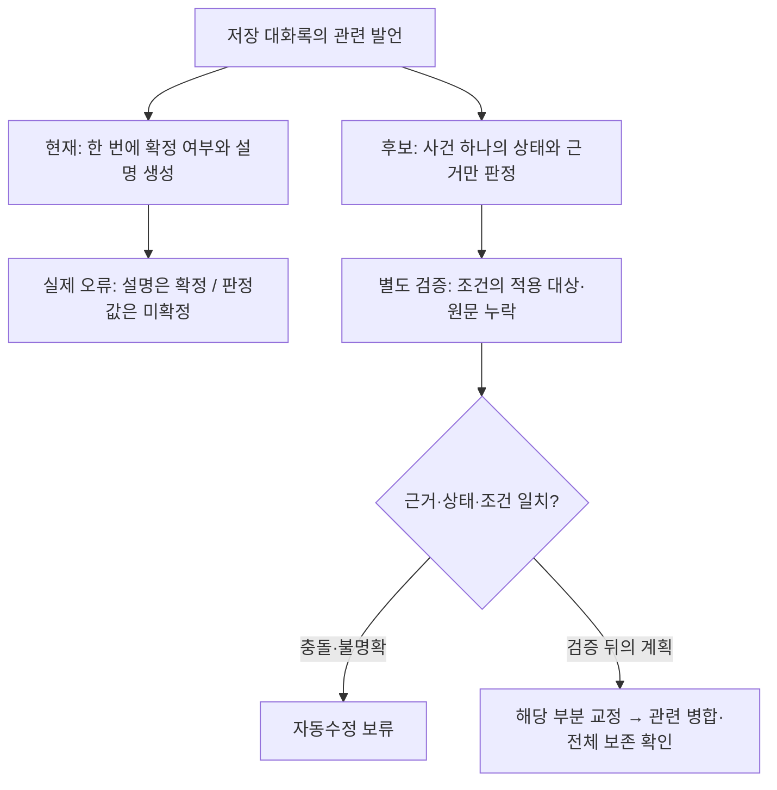

# 웹 우선 로컬 엔진 실행 계획

- 결정일: 2026-07-28
- 방향 갱신: 2026-08-13
- 상태: 현재 우선 제품 방향. 공통 React UI를 웹 제품으로 먼저 완성한다.
- 착수 조건: 데스크톱 앱 완료가 선행 조건이 아니다. 웹 UI와 로컬 엔진의 최소 연결·보안 계약부터 검증한다.
- 첫 웹 제품: HTTPS 웹 UI + 사용자가 한 번 내려받는 Windows 로컬 엔진
- 병행 제품: Windows Tauri 데스크톱 앱과 HTTPS 웹을 함께 지원하며 기록은 각각 보관한다(2026-10-22 결정). 실제 실행 파일의 공존 검증은 별도 관문이다.
- 세부 구현 순서와 완료 기준: `docs/web-runtime-separation-implementation-plan.md`

## 1. 제품 결정

### 2026-10-22 웹·데스크톱 병행과 기록 분리

동일한 UI와 분석 코드를 재사용하되 웹과 데스크톱은 각자의 엔진·설정·결과 경로를 사용한다. 자동 동기화나 기존 기록 이동은 이번 범위에 포함하지 않는다.

| 구분 | HTTPS 웹 | Windows 데스크톱 앱 |
| --- | --- | --- |
| 실행 | 브라우저 + 설치한 Windows 로컬 엔진 | Tauri 실행 파일 + 앱이 시작한 엔진 |
| 현재 기록 목록 | 브라우저의 해당 사이트 IndexedDB | Tauri WebView의 IndexedDB |
| 설정·결과·모델 | `%LOCALAPPDATA%\Barorok\LocalEngine` | portable 앱의 `backend`·`models`·`runtime` 경계 |
| 엔진 포트 | `127.0.0.1:17863` 고정 | `17864`부터 빈 포트 선택, 실패 시 OS 선택 포트. `17863` 제외 |
| 업데이트 | 웹 자산과 설치 엔진을 구분해 갱신 | 앱 코드를 갱신하되 기존 설정·결과·다운로드 자원 보존 |

현재 기록 목록은 양쪽 모두 IndexedDB에 있으므로 브라우저 사이트 데이터 또는 WebView 프로필을 삭제하면 목록을 잃을 수 있다. 엔진에 결과 JSON이 남는 것만으로 목록이 자동 복원되지는 않는다. 계획된 SQLite 전환은 각 제품의 저장 경계 안에서 진행하며 이번 결정을 전환 완료로 표현하지 않는다.

두 창을 함께 열어도 분석 자원까지 분리되지는 않는다. RAM·GPU와 시스템 Ollama를 공유할 수 있어 우선 분석은 한쪽씩 실행한다. 모델을 각 경계에 준비하면 디스크 사용량도 늘어난다. 동시 분석 보장이나 모델 저장소 공유는 이번 범위 밖이다.

현재 소스에서 포트 충돌·업데이트 데이터 보존·전달 ZIP의 개인 데이터 제외를 보완했다. 후속 검토에서 기존 설치본 검사를 읽기 전용으로 분리하고 검증 후 재귀 삭제를 제거했다. portable 내부 비표준 결과/임시 경로와 backend 내부 사용자 모델/활성 양식은 변경·포장 전에 안전하게 거부하며 자동 이전하지 않는다. 독립 리뷰에서 누락됐던 `summary.model`의 내부 파일 경로도 보호하고, 동기화 뒤 deploy를 재해시하지 않고 검증된 빌드 manifest와 비교하도록 수정했다. 두 사례의 회귀 검사는 임시 fixture에서만 실행했다. 모의 양쪽 기록/삭제 격리 검사까지 통과했지만 실제 Tauri 후보의 저장·재열기, 두 실행 순서, 한쪽 종료 후 다른 쪽 유지, 실제 업데이트·버전 조합 검증은 `web-runtime-separation-implementation-plan.md`의 release QA 표에서 관리한다. 기존 장문 요약의 공개 배포 보류는 유지한다.

### 2026-10-20 0.1.9 새 설치본과 운영 웹 갱신

- 실행 코드 기준 `ad7cb53`에서 운영 Origin용 엔진 `0.1.9-beta-20261020`을 새로 빌드했다. 웹은 같은 커밋의 `git archive HEAD desktop-app configs`로 만들었으며 다른 작업의 미커밋 Sidebar/CSS/font 변경을 포함하지 않는다. 설치 파일은 NSIS3.13으로 새 preflight helper와 함께 생성했다. EXE `442838807`bytes, SHA256 `c29823454971472cbbf110651b7c3151a2af2eccbbab3937fc45d16116de273a`; unsigned/testRelease 상태를 유지한다.
- 이 PC에서 실행 중인0.1.8 위 실제 업데이트는45.36초/exit0이었다. 강제 종료 없이 새버전 probe, 설치 payload4957파일 전수 해시, exact Origin 자동 연결·보호 health200/무인증401·타Origin403, 실제 재시작 후 복원·명시적 해제 후401을 확인했다. 설정·회의록·DB198관측 경로의 SHA와 모델146관측 경로의 크기는 불변이다(physical/가상화 중복 경로 포함). 새 엔진은 실행 상태로 남겼다. 새 설치·제거 후 재설치를 이 업데이트 검사로 대체하지 않는다.
- 설치된 helper의 모델·작업 임시 공간·결과 공간 점검은 모두pass이며 unknown이 없다. 실행 중인 자기 엔진에 대한 fixed-port 경고만 남는다(exit10, `stop_local_engine_and_retry`). 따라서 이 결과를 엔진 종료 상태의 전체 preflight exit0으로 기록하지 않는다. 시작 메뉴의 `음성 분석 시작/종료/제거`, `LMO 회의록 연결`도 확인했다. 근거 `.tmp/release-019-20261020/{source-state.json,installer-manifest.json,installed-verification.json,preflight-verification.json,web-build-manifest.json}`.
- 공개 반영 완료: 다운로드 정보 커밋 `c5f0cc6`, 운영 Worker version `09a485ac-a9a0-45d7-9335-22d0fa7fd62c`. 설치 파일 전체 R2 read-back SHA 일치 후 웹을 배포했고 공개 웹6파일 SHA, installer metadata/HEAD/Range/416/405/404, 이전0.1.5 원본·installerfix·0.1.8 링크3개의307/no-store를 확인했다. 격리 Chromium의 제어된 LNA 허용 상태에서 실제 설치 엔진019의 probe/보호 health/models200, 첫 자동 연결과 reload 복원, 화면 `연결됨`·활성 `분석 시작`을 확인했다. 첫 QA 실행은 옛 문구 `분석 준비 완료`를 기다려 실패했으나 화면/응답은 정상이었고 현재 문구로 검사만 고쳐 통과했다. 제품 소스 변경은 없다. 사람 권한창·Edge/조직 정책 검증으로 확대하지 않는다.
- 임시 업로드 Worker `barorok-upload-019-20261020`와 로컬 `.dev.vars`는 삭제했다. 공개 브라우저 시험은 자동 복원 등록 파일만 정상 갱신했으며 그2관측 경로를 제외한 기존196경로 SHA·모델146경로 크기는 최종 검사에서도 불변이다. 사용자 모델·회의록은 전송하지 않았다. 전체 증거는 같은 QA 폴더의 `final-audit.json`, `uploader/upload-result.json`, `public-verification.json`, `browser-verification.json`과 `production-connected.png`/`production-restored.png`다. 릴리스 관문의 상태·필요 증거·종료 조건은 기존 release QA 표에 갱신했다.

### 2026-10-20 설치 후 연결 안 됨: 브라우저 권한과 확장의 Origin 변경

- 증상: 설치 후 '연결 확인'을 눌러도 화면 변화가 없음. 공개 웹에서 재현하면 실패 요청이 수 ms 만에 끝나 '연결 확인 중'이 보이지 않고 같은 실패 문구로 돌아간다.
- 개발 PC에 공개 0.1.8(SHA 일치, exit0)을 실제 설치하고 실제 Chrome 155로 확인했다. 엔진 probe200·공개 Origin CORS는 정상이었다. 차단은 브라우저 쪽에서 두 겹으로 일어났다.
  1. 사이트 권한 `loopback-network`(‘기기에 있는 앱’)가 처음부터 거부라 요청이 엔진에 닿지 않았다.
  2. 허용 뒤에도 Page Assist 확장의 저장된 DNR 동적 규칙(`requestDomains:["127.0.0.1"]`, Origin을 `http://127.0.0.1`로 설정, initiator 제한 없음)이 모든 127.0.0.1 요청의 Origin을 바꿨다. 엔진이 ACAO를 붙이지 않아 CORS가 실패했다. 이때 요청은 엔진에 200으로 도착하고 no-cors 요청은 성공한다.
- 확장을 끄자 코드·Windows 승인 없이 자동 연결(`pair/start`→`complete`)과 reload 복원(`pair/restore`)이 통과했다. 엔진이 `http://127.0.0.1` Origin을 허용하도록 바꾸지 않는다. 그러면 그 확장이 있는 브라우저의 모든 사이트가 엔진에 접근할 수 있다.
- 웹 수정(미배포): 권한 거부와 '응답은 왔지만 브라우저가 결과를 막음'(권한 허용 또는 권한 API 없음 + CORS 실패 + no-cors 성공)을 각각 안내한다. 후자는 이 사이트를 허용하지 않는 예전 설치본일 수도 있어 확장 확인과 재설치를 함께 안내한다. 권한이 아직 '묻는 중'이면 추가 요청이 Chrome 팝업을 다시 띄우므로 no-cors 확인을 하지 않는다. 엔진 꺼짐 안내와 구분하고, 차단 안내가 세션 만료·연결 오류·업데이트 안내보다 우선한다. 수동 재확인은 최소 700ms '연결 확인 중'을 보인다. 검증은 `test-local-engine-browser-access.mjs`와 `simulate-local-engine-connection-ui.mjs`의 `browser-blocked` 시나리오다.
- 권한이 아직 '묻는 중'일 때(첫 방문): Chrome 기본값은 차단이 아니라 묻기다. 이 PC의 '거부'는 사이트의 자동 차단 기록과 함께 있었다(팝업을 반복해서 닫은 결과로 추정, 허용 뒤 기록이 지워져 확정 못 함). 페이지 로드·10초 재확인·포커스·설정/모델 조회가 설명 없이 팝업을 띄워 닫히기 쉬웠다. 공통 엔진 요청 통로에 권한 대기를 둬서 공개 사이트에서 '묻는 중'이면 사용자의 '연결 확인' 요청만 보낸다. 페이지가 127.0.0.1/localhost이거나 데스크톱 앱이면 적용하지 않고, 엔진이 한 번이라도 응답하면 대기를 푼다. 첫 화면과 확인 중에 '허용' 안내를 보인다. 확인 뒤에도 '묻는 중'이면 팝업을 닫았거나 엔진이 응답하지 않은 것이다. Chrome 155는 닫힌 포트에 팝업 없이 4ms 만에 실패해서 두 경우를 구분할 수 없다. 그래서 설치·실행 안내와 설치 파일 버튼을 유지하고 허용 안내를 덧붙인다. 사용자 확인이 진행 중이면 배경 재확인을 건너뛴다. 검증은 `simulate-local-engine-connection-ui.mjs`의 `permission-prompt` 시나리오(앱을 `https://barorok.test`로 제공)다.
- 설치 중 Yes/No 질문 원인: manifest에 모델·분석 임시·결과 공간 기준이 없어 점검이 unknown(exit10)이 된다. 정상 PC에도 매번 떴다. 2026-10-20 release build가 기준값을 넣도록 고쳤다(아래 `설치 전 점검: 모델·작업 공간 크기와 표시 이름 — 2026-10-20`).
- 첫 문제 PC에도 Page Assist나 다른 헤더 변경 확장이 있는지는 아직 확인하지 않았다.

### 2026-10-20 연결 등록 포화·부분 결과 안내 P2 수정

- 사이트 데이터 삭제·시크릿 방문 뒤 남은 등록 때문에 17번째 연결부터 영구 거절되는 결함을 회귀 테스트로 재현했다. 최근 사용 순서로 기억한 브라우저 자격을 최대 16개 유지하고, 새 연결 승인 완료 때 가장 오래 사용하지 않은 등록을 교체한다. 복원한 등록은 최근 순서로 저장하며 기존 format 1 JSON을 그대로 읽는다. 거절·취소·저장 실패는 등록 교체를 확정하지 않는다.
- 등록 교체는 다음 방문의 자동 복원 자격만 정리한다. 다른 브라우저의 진행 중인 작업을 끊지 않도록 기존 짧은 API 세션은 유지하며, 사용자가 명시적으로 해제하면 교체된 등록의 관련 세션도 철회한다. Origin 제한·호출 횟수 제한은 유지한다.
- GPU 메모리 부족이 대화록 저장 뒤 발생하면 저장 보존·미완료 단계 안내를 우선한다. 저장된 대화록이 없는 GPU 오류의 분석 장치 설정 안내는 유지한다. 기존 실패 원인 시뮬레이션은 CPU·GPU 두 조건에서 보존 문구와 결과 열기를 확인한다.
- 검증: 프로젝트 `backend\.venv-desktop\Scripts\python.exe` 3.12.14의 연결/보안 unittest 43개, 에이전트 제안 세션 철회 단언 추가 뒤 연결 모듈 13개 재검사 통과. `COREPACK_HOME=C:\Users\User\AppData\Local\node\corepack`와 캐시된 `corepack pnpm@10.33.2`로 typecheck·변경 파일 ESLint·브라우저 연결 Node 10개 통과. 실제 UI의 `simulate-analysis-stop-flow.mjs failure-causes` 10개는 API를 대체한 Chromium 검사이며 새 CPU·GPU 결과 열기를 포함한다. 첫 실행의 최초 화면 시간 초과 뒤 HTTP 준비 확인을 추가한 재실행은 전부 통과했다. 검토용 Vite는 `desktop-app`에서 `node node_modules/vite/bin/vite.js --host 127.0.0.1 --port 5198 --strictPort --configLoader runner`로 시작하고 검사 후 종료했다. 보안·화면 에이전트 재검토에서 새 지적 없음.
- 소스 검증과 실제 공개 HTTPS·설치 엔진 반영은 구분한다. 설치본 확인 대기는 `web-runtime-separation-implementation-plan.md`의 「연결 등록 교체·부분 결과 안내 반영」 행에서 관리한다.

### 2026-10-20 설치 후 자동 연결

사용자는 자신의 PC에 설치한 엔진을 바로 쓰는 흐름을 요청했다. 숫자 코드와 추가 Windows 승인 창을 제거한다. 설치 때 고정한 바로록 HTTPS Origin만 새 브라우저 연결을 만들 수 있고, 브라우저의 앱 접근 권한은 그대로 따른다. 브라우저 난수 자격은 localStorage, 엔진에는 해시만 저장하며 짧은 API 세션과 분리한다. 새로고침·엔진 재실행은 복원하고 명시적 해제는 관련 세션 전체를 철회하며 현재 방문에서 자동 재연결을 중단한다. 저장소가 차단돼도 현재 방문의 메모리 자격으로 해제할 수 있다. `--pair`는 기존 바로 가기 호환용 엔진 시작 별칭이다.

소스 검사: backend 56개, 자동 연결·취소·해제·복원 Node 10개, 기존 인증 복구 22개·API 경계 10개, typecheck·변경 파일 lint 통과. UI 모의 검사에서 코드 입력 없음·자동 첫 연결·reload 복원·기존 준비 상태 복구를 확인했다. 이 검사를 실제 공개 HTTPS 통과로 확대하지 않는다.

실물 후보 `0.1.8-beta-20261020`은 소스861e586으로 새 frozen 엔진/closed manifest를 만들고 검증된 TMP/TEMP 수정 helper를 재사용했다. NSIS3.13 컴파일은 기존 미사용 label 경고3개다. EXE442815954bytes·SHA256 `c9415057adc02938df6d2c625f50438a3aabab5b424fb18484f41d15f54e2e62`, unsigned/testRelease 후보이며 정식 출시 완료가 아니다. 이 PC에서 실행 중이던0.1.5를 실제 업데이트해 exit0/46.31초·미완료 표시 없음·새버전 probe를 확인했다. `--pair` 별칭 exit0/추가 창 없음, 정확한 Origin의 무코드 연결·보호 health200/무인증401·타Origin start/restore403, 실제 stop/재실행 후 저장 자격 복원·해제 후 세션/복원401을 통과했다. 기존 기록/설정/DB196경로 SHA·모델146경로 크기는 불변이며 논리/physical 중복 관측을 포함한다. 실모델 분석을 재실행한 검사는 아니다. 새 엔진은 실행 상태로 남겼다. 근거 `.tmp/browser-connection-20261020/{installer-manifest.json,installed-verification.json,web-build-manifest.json}`.

공개 반영 완료(2026-10-20): 자동 승인 검토 거절 뒤 사용자가 임시 업로드 Worker 생성·새 EXE 전송·검증 후 삭제·운영 웹 동시 배포를 구체적으로 승인했다. 새 파일442815954bytes 전체 R2 read-back SHA 일치 후 운영 Worker version `00311f46-d6de-4d4c-a3e1-2661672f8f11`을 배포했다. 새 웹6파일은 `git archive HEAD desktop-app` 기반으로 다른 작업의 미커밋 Sidebar/CSS/font 변경을 제외했고 실제 공개6개 bytes/SHA와 metadata/HEAD/Range/416/405/404, 이전0.1.5 원본·installerfix URL의307/no-store를 확인했다. 임시 업로드 Worker `barorok-upload-connect-20261020`와 로컬 인증 파일은 삭제했다. 현재 Chrome의 같은 공개 탭에서 입력/파일이 비어 있음을 확인 후 reload했고 숫자 코드·별도 Windows 승인 없이 연결됐다. 첫 방문 처리 안내만 닫았고 다시 reload해 자동 복원과 최종 `분석 준비 완료`를 확인했다. 브라우저 보안 설정 변경·새 음성 분석은 없으며, 공개 첫 연결/reload 통과를 Edge·회사 정책·실제 업로드/본문 Network 관문 완료로 확대하지 않는다. 근거는 같은 QA 폴더의 `upload.log`, `uploader/upload-result.json`, `public-deploy.log`, `public-verification.json`, `browser-verification.json`, `public-connected.png`다.

첫 웹 버전은 여러 실행 방식을 동시에 제공하지 않는다.

현재 사용자에게 제공할 제품 표면은 웹사이트다. `LMO Local Engine Setup.exe`는
웹 기능을 각 PC에서 로컬로 실행하기 위한 백그라운드 분석 구성요소이며,
별도의 데스크톱 앱 화면으로 취급하지 않는다.

사용자가 웹에 접속한 뒤 LMO Local Engine Setup.exe 하나를 내려받아 현재 사용자 영역에 설치하고, 이후 음성 인식·영상 오디오 추출·참석자 구분·AI 정리는 사용자 PC에서 실행하는 구조를 선택한다.

    HTTPS 웹 UI
          |
          | Chrome/Edge Local Network Access 승인
          v
    127.0.0.1:17863 로컬 엔진
          +-- native ffmpeg
          +-- faster-whisper
          +-- 선택형 pyannote
          +-- 앱 관리 Ollama
          +-- 로컬 모델·SQLite·결과 파일

서버는 React UI, 설치 파일, 서명된 업데이트 manifest와 모델 manifest를 배포한다. 사용자가 선택한 음성·영상과 생성된 대화록은 기본적으로 원격 분석 서버로 전송하지 않는다.

## 2. 이 방향을 선택한 이유

### 현재 코드 재사용

- Tauri 앱은 이미 외부 Python 백엔드 sidecar를 포함하고 앱 시작 시 자동 실행한다.
- React UI는 VITE_API_BASE_URL과 loopback API를 사용할 수 있다.
- native ffmpeg, faster-whisper large-v3, 선택형 pyannote, 앱 관리 Ollama 경로를 그대로 발전시킬 수 있다.
- 순수 BrowserEngine을 새로 만드는 것보다 데스크톱과 결과 품질·기능을 맞추기 쉽다.

### 2026년 기술 확인

- Tauri 2는 Python API 서버 같은 외부 바이너리를 sidecar로 묶는 방식을 공식 지원한다.
- Tauri의 Windows NSIS 설치는 기본적으로 현재 사용자 영역 %LOCALAPPDATA%에 설치되어 관리자 권한이 필요하지 않는다.
- Tauri autostart 플러그인은 Windows 시작 시 앱 자동 실행을 지원한다.
- Chrome 142부터 공개 HTTPS 사이트가 loopback 주소에 연결할 때 Local Network Access 권한 승인이 필요하다. 최초 연결 안내와 권한 거부 복구 UX가 필수다.
- Ollama는 기본적으로 loopback HTTP API로 동작한다. 웹 UI가 Ollama에 직접 접근하지 않고 로컬 엔진이 인증된 프록시 역할을 맡는다.

순수 브라우저 실행도 기술적으로 가능하다. ONNX Runtime Web은 WASM과 WebGPU 실행을 제공하고 Transformers.js와 whisper.cpp는 브라우저 Whisper 예제를 제공한다. 그러나 브라우저·GPU 편차, 큰 모델 메모리, 영상 코덱, 탭 생명주기, 화자 구분 이식 비용 때문에 첫 웹 제품으로 선택하지 않는다. 기존 실측과 설계는 후순위 무설치 제품 후보의 근거로 보존한다.

## 3. 사용자 흐름

1. 사용자가 HTTPS 웹사이트에 접속한다.
2. 첫 방문에서는 연결 안내를 읽고 `로컬 엔진 연결`을 눌러 Chrome/Edge의 Local Network Access 승인을 시작한다. 이미 권한·pairing된 브라우저만 자동 재연결한다.
3. 웹 UI가 127.0.0.1:17863의 공개 probe로 제품 식별자와 API 계약을 확인한다.
4. 연결할 수 없으면 `로컬 엔진 받기`를 주 CTA로 보여 주고, 실행 후 다시 연결과 문제 해결은 보조 동작으로 제공한다. 이 상태만으로 미설치를 단정하지 않는다.
5. 사용자가 코드 서명된 NSIS 설치 파일을 내려받아 현재 사용자 영역에 설치하고 로컬 엔진을 실행한다.
6. 설치 완료 화면이나 시작 메뉴의 `바로록 연결` helper가 origin과 일회성 코드를 표시하고 사용자가 웹에 입력해 최초 pairing을 승인한다.
7. 웹 UI는 짧은 수명의 세션 토큰으로 인증하고 만료·폐기 시 재pairing을 안내한다.
8. 첫 분석 전에 필요한 STT 모델의 크기와 저장 위치를 보여 주고 기존 로컬 엔진 다운로드 기능을 사용한다.
9. 요약 기능을 처음 사용할 때만 앱 관리 Ollama runtime과 선택한 요약 모델을 별도로 받는다.
10. 음성·영상 분석, 중지·이어하기, 내보내기는 로컬 엔진에서 수행한다.

초기 Windows 웹 MVP에서는 설치형과 portable 엔진을 동시에 제공하지 않는다. 자동 시작·업데이트·장애 복구가 일관된 현재 사용자 단위 NSIS 설치형만 제공한다.

## 4. 패키지와 업데이트 원칙

- 설치 파일은 Windows 코드 서명을 적용한다. 브라우저에서 받은 서명되지 않은 실행 파일은 SmartScreen 경고와 회사 보안 차단 가능성이 크다.
- 엔진 본체, ffmpeg, Python sidecar는 설치 파일에 포함한다.
- STT·화자 구분·요약 모델은 설치 파일에서 분리하고 필요할 때만 받는다.
- 모든 엔진·모델 manifest에는 버전, 크기, SHA-256, 다운로드 URL을 고정한다.
- 대용량 다운로드는 진행률, 남은 시간, 중지, 이어받기, 해시 검증을 지원한다.
- 엔진 업데이트는 서명된 update manifest를 검증한 뒤 적용하고 모델과 사용자 데이터는 보존한다.

현재 저장 크기의 기준값은 구현 시 다시 측정한다. 2026-07-28 개발 산출물은 backend sidecar 약 72MB, backend 리소스 약 203MB이고, 현재 large-v3 STT 모델 registry 값은 약 3.1GB다. 이 값은 최종 설치 파일 용량 약속이 아니다.

## 5. 보안 경계

- 로컬 엔진은 127.0.0.1에만 bind하고 LAN이나 공인 주소에 노출하지 않는다.
- 허용 origin은 런타임별 exact allowlist로 관리한다. 웹 로컬 엔진은 실제 배포 HTTPS origin만, Tauri sidecar는 고정 Tauri origin만 허용하고 localhost는 개발 모드에만 둔다. wildcard origin은 사용하지 않는다.
- CORS는 인증이 아니다. 설치별 비밀값, 일회성 pairing, 짧은 수명의 세션 토큰을 별도로 적용한다.
- 공개 probe와 Origin 검증을 통과한 pairing endpoint 외 모든 `/api/**` 읽기·쓰기·SSE·결과·다운로드는 기본 인증한다.
- 웹 UI는 Ollama 11434 포트에 직접 연결하지 않고 로컬 엔진을 통해 제한된 생성 기능만 호출한다.
- 다운로드 manifest와 실행 파일 서명 검증 실패는 우회하지 않는다.
- 로그에는 음성 원문, 전체 대화록, pairing 비밀값을 기록하지 않는다.

## 6. 저장과 소유권

- 웹 origin별 IndexedDB만을 영구 기록의 단일 원본으로 사용하지 않는다.
- 웹 제품에서는 로컬 엔진 SQLite만 기준 저장소(canonical storage)로 두고 React UI는 API를 통해 조회·수정한다. 결과 JSON, HWPX와 다른 파일은 SQLite revision에서 재생성 가능한 파생 산출물이다.
- 데스크톱 MeetingRecord, backend 결과 JSON, /sync-record, /export-record 계약을 먼저 정리한 뒤 같은 저장 계약을 웹에서 재사용한다.
- 브라우저 캐시 삭제, 다른 브라우저 사용, 웹 origin 변경 후에도 로컬 회의 기록이 남아 있어야 한다.

## 7. 웹 우선 착수 게이트

웹 구현은 데스크톱 portable 완료를 기다리지 않는다. 다음 최소 조건을
순서대로 닫으면서 진행한다.

1. 공통 React UI의 `build:web`, typecheck와 관련 Playwright 시뮬레이션이 통과한다.
2. 웹 UI가 로컬 엔진 연결 불가·설치 안내·연결됨·업데이트 필요 상태를 과장 없이 구분한다.
3. loopback 연결, exact origin allowlist, pairing과 세션 인증의 최소 PoC가 통과한다.
4. 음성·영상 파일이 원격 서비스로 전송되지 않는 것을 네트워크 수준에서 확인한다.
5. STT 모델을 필요한 시점에 내려받고 중지·이어받기·해시 검증할 수 있다.
6. 로컬 엔진 SQLite를 웹 회의 기록의 유일한 기준 저장소로 확정하고 결과 파일은 파생 산출물로 재생성한다.

브라우저에서 React 화면이 열린다는 사실만으로 웹 MVP가 완성된 것으로 보지
않는다. 실제 로컬 엔진 설치·연결·분석·복구·다운로드까지 확인한다.

## 8. 웹 구현 순서

아래는 제품 단계의 요약이다. 코드 경계, 기존 기능 재사용 목록, 상태 모델,
검증 행렬은 `docs/web-runtime-separation-implementation-plan.md`를 기준으로 한다.
상위 단계는 제품 출시 게이트이고 세부 문서의 단계는 코드 작업 순서다.
설치·연결 UX를 실제 사용자에게 배포하기 전에 공개 probe, exact origin과
pairing/session 최소 PoC를 먼저 통과한다.

### 0단계: 로컬 엔진 분리 PoC

- 현재 Python backend와 배포 자산에서 창 없는 로컬 엔진 패키지를 분리한다.
- 고정 loopback 포트, single instance, health, 종료·재시작을 검증한다.
- 현재 데스크톱과 같은 60초 음성 파일의 결과·시간을 비교한다.

### 0.5A단계: 사용자 PC 호환성 기준

- 첫 공식 지원 후보를 Windows 11 x64와 최신 stable Chrome·Edge로 제한하고,
  Windows 10 x64·Windows 11 ARM64는 실제 설치·분석 증거 전까지 미지원 후보로 둔다.
- 저사양 CPU-only, 일반 CPU-only, NVIDIA GPU에서 최소·권장 CPU·RAM·여유 디스크와
  대표 파일 길이별 예상 처리시간을 정한다.
- 프록시·오프라인·Defender·SmartScreen·조직 EDR·관리 브라우저, 한글·긴 경로,
  디스크 부족, 포트 충돌, 절전·재개와 다중 Windows 사용자를 검증 행렬에 포함한다.
- 설치 전에 환경·모델·저장 공간·포트·브라우저 권한을 구분해 확인하고,
  지원 요청에는 token·코드·대화록을 제외한 진단 자료만 제공하도록 한다.
- 첫 MVP는 한 PC의 한 활성 Windows 사용자 세션만 지원한다. 다중 사용자·RDP
  동시 사용은 고정 포트 발견 계약을 바꾸고 별도 검증하기 전에는 지원하지 않는다.

### 0.5B단계: 단계별 자동 점검

- 웹은 설치 전에 지원 OS·브라우저 안내만 하고 RAM·디스크·GPU를 추측하지 않는다.
- host system preflight는 OS·workstation·native architecture·RAM만 확인한다.
- installer target preflight는 실제 설치·모델·임시·결과 볼륨 공간,
  LocalAppData 쓰기와 포트 상태를 확인한다.
- 엔진 시작 뒤에는 ffmpeg·native dependency·모델·Ollama와 GPU 가속 후보를,
  실제 HTTPS 웹에서는 Local Network Access·pairing·version을 확인한다.
- 분석 직전에는 현재 파일과 모델을 기준으로 temp·results 공간과 예상 처리 부담을
  다시 확인한다.
- 자동 점검은 `pass`, `warning`, `blocked`, `unknown`을 구분한다. 확실한 미지원과
  현재 작업을 수행할 수 없는 조건만 막고, 느린 환경은 예상 지연과 계속 진행을
  제공하며, 확인 불가는 실패로 단정하지 않는다.
- 모든 경고에는 다시 확인·공간 확보·권한 확인·관리자 요청·진단 내보내기 중
  가능한 다음 행동을 제공하고 보안 기능 해제나 강제 프로세스 종료를 권하지 않는다.
- 2026-08-14 현재 host system과 installer target preflight의 versioned JSON,
  Windows source·frozen 실행 검증을 완료했다. 이어서 NSIS가 artifact manifest의 확정
  byte 요구량과 결과 action을 소비하는 current-user installer 소스, Start Menu 동작,
  same-volume stage·rollback과 선언 파일 기반 정리 계약까지 작성하고 좁은 테스트를
  통과했다. 모델·temp·results 권장량은 추측하지 않고 후속 실측 전까지 `unknown`으로 둔다.
  2026-10-20부터는 release build가 이 세 값을 manifest에 기록한다(아래
  `설치 전 점검: 모델·작업 공간 크기와 표시 이름 — 2026-10-20`).
- 모델 제외 frozen payload도 Python 분석 runtime과 native dependency 때문에 현재
  1,117,850,125 bytes(4,887 files, 약 1.04 GiB)다. 회사 PC에서는 이를 다시 build하거나
  설치하지 않았으며, 실제 helper/NSIS compile과 fresh install·update·중단 복구·uninstall
  smoke는 집 PC 관문으로 남긴다. 외부 배포 전에는 기능 회귀를 동반한 payload slimming과
  코드 서명을 별도로 닫아야 한다.

### 1단계: 설치·연결·보안

- 현재 사용자 단위 NSIS 설치와 명시적 autostart 설정
- Windows 코드 서명
- HTTPS 배포 origin exact allowlist
- Local Network Access 승인·거부·재승인 UX
- 설치별 pairing과 API 인증
- 서명된 엔진 업데이트

### 2단계: 웹 회의록 MVP

- 같은 React UI의 웹 빌드
- 로컬 엔진 상태·버전·업데이트 표시
- 파일 분석 SSE, 중지·이어하기
- 모델 받기와 상태 관리
- SQLite 회의 기록 조회·편집·내보내기
- 회의·결정·할 일 통합 검색과 원래 회의록 이동
- 브라우저 새로고침·재접속 복구

### 3단계: 웹 기능 확장

- 선택형 참석자 구분
- 전체·주제별·참석자별 정리
- MD/TXT/DOCX/HWPX 내보내기
- 결정 일시·상태·근거 발언·후속 변경을 구조화한 결정 이력
- 근거 회의와 발언 시각을 함께 보여 주는 회의 간 질문
- 실제 30분·60분·장시간 영상 검증
- 회사 Chrome/Edge 정책과 백신 환경 검증

### 별도 후속: 내부망 HWPX 문서 작업

- 기록 찾기에서 사용자가 확인한 회의·결정·할 일을 보도자료, 결과보고서, 기관 회의록 초안의 입력으로 사용한다.
- HWPX 템플릿 매핑과 문서 생성부터 먼저 안정화하고, 편집기·미리보기·저장·재열기는 별도 작업으로 설계한다.
- 생성 문서에는 원 회의록과 근거 발언을 추적할 수 있는 내부 출처 정보를 유지한다.
- 이 작업은 웹 회의록 MVP와 동시에 구현하지 않으며, 로컬 SQLite 저장 계약과 결정 데이터 구조화 이후 진행한다.

## 9. 보류 항목

- 순수 WASM/WebGPU BrowserEngine
- WebLLM 기반 브라우저 요약
- remote SaaS 분석
- 모바일·PWA
- portable 로컬 엔진
- 여러 운영체제 지원
- Windows Tauri 데스크톱 앱 제품화와 portable 배포
- 내부망 HWPX 편집기와 보도자료 생성

이 항목들은 첫 웹 MVP와 병행하지 않는다. Windows 로컬 엔진 웹 제품을 검증한 뒤 별도 제품 결정을 거쳐 활성화한다.

## 10. 2026-07-28 공식 자료

- Tauri external binaries: https://v2.tauri.app/develop/sidecar/
- Tauri Windows installer: https://v2.tauri.app/distribute/windows-installer/
- Tauri autostart: https://v2.tauri.app/plugin/autostart/
- Tauri Windows code signing: https://v2.tauri.app/distribute/sign/windows/
- Tauri updater: https://v2.tauri.app/plugin/updater/
- Chrome Local Network Access: https://developer.chrome.com/blog/local-network-access
- Ollama FAQ and origins: https://docs.ollama.com/faq
- ONNX Runtime Web: https://onnxruntime.ai/docs/tutorials/web/
- Transformers.js WebGPU and Whisper: https://huggingface.co/docs/transformers.js/en/guides/webgpu
- whisper.cpp WASM: https://github.com/ggml-org/whisper.cpp

## 11. Cloudflare 배포 준비 — 2026-10-18

사용자는 Cloudflare를 배포 대상으로 선택했다. 목표는 **HTTPS 웹 접속 → 로컬 엔진 받기 → 설치 → 웹 연결 → 모델 준비 → 분석·저장·내보내기**다. GitHub push, Vite 화면 열기, 로컬 검사 설치 파일 생성은 이 배포 완료를 뜻하지 않는다.

### 준비한 구성과 명령

- 웹: `deploy/cloudflare/wrangler.jsonc`의 Workers Static Assets. 사용자 요청으로 Worker 이름에서 `-web`을 제거했다. `barorok` 이름의 기존 배포가 없는 것을 확인한 뒤 같은 계정·웹 자산으로 배포했다. 현재 검사 사이트는 `https://barorok.ecomarin.workers.dev`다.
- 웹 빌드: `corepack pnpm --dir deploy/cloudflare prepare:web`. 기존 디자인 작업의 `desktop-app/dist` 대신 `.tmp/cloudflare-web/dist`에 생성한다. 이 명령은 업로드하지 않는다.
- 연결 화면은 켜고, API는 사용자 PC의 `http://127.0.0.1:17863`으로 고정한다. 다운로드 주소를 생략하면 기존 `.env` 값도 덮어써 검사본 링크가 노출되지 않게 한다.
- 배포용 설치 파일 검증이 끝나면 `powershell -NoProfile -ExecutionPolicy Bypass -File scripts/prepare_cloudflare_web.ps1 -InstallerUrl <검증된-HTTPS-설치파일-주소>`로 다시 빌드한다. 업데이트 주소는 검증된 경로가 있을 때만 `-UpdateUrl`로 별도 지정한다. 이 인자는 서명 검증을 대신하지 않는다.
- 설치 파일은 웹 자산 폴더에 넣지 않는다. 비공개 R2에 버전별 파일명으로 보관하고 같은 웹 Worker의 `/downloads/`에서 지정한 파일만 전달한다. 사용자용 HTTPS 다운로드 주소, 파일 크기, SHA-256을 release manifest와 맞추며 `r2.dev` 공개나 별도 custom domain은 사용하지 않는다.
- 현재 약 443MB인 검사 설치 파일은 Wrangler 단일 업로드 한도(315MB)를 넘는다. 이번에는 별도 S3 키 없이 인증·만료·고정 key·크기 제한을 적용한 임시 Worker로 분할 업로드(multipart upload)하고 전체를 다시 읽어 해시를 확인한다. 확인 후 임시 Worker는 삭제한다. [공식 업로드 기준](https://developers.cloudflare.com/r2/objects/upload-objects/)
- 계정 확인: `corepack pnpm --dir deploy/cloudflare whoami`.
- 계정 로그인: `corepack pnpm --dir deploy/cloudflare login`. 사용자가 브라우저에서 계정 인증을 완료한다. 토큰을 채팅이나 소스에 붙여 넣지 않는다.
- 로컬 배포 검사: `corepack pnpm --dir deploy/cloudflare check` (`wrangler deploy --dry-run`). 실제 배포: `corepack pnpm --dir deploy/cloudflare run deploy` (`deploy`는 pnpm 내장 명령과 구분해 반드시 `run`을 붙인다).

Wrangler `4.151.1`은 별도 의존성으로 고정했다. 설치는 저장소 루트에서 `corepack pnpm --dir deploy/cloudflare install --store-dir .cache/pnpm-cloudflare`로 한다. Windows 인증 저장소 모듈이 없으면 `.cache/cloudflare-auth/.wrangler/native/keyring` 폴더를 만든 뒤 `corepack pnpm --dir .cache/cloudflare-auth/.wrangler/native/keyring add @napi-rs/keyring@1.3.0 --store-dir .cache/pnpm-cloudflare`로 준비한다. 전역 설치나 인증 저장소 비활성화로 우회하지 않는다.

`wrangler.mjs`는 `XDG_CONFIG_HOME=<저장소>/.cache/cloudflare-auth`, `XDG_CACHE_HOME=<저장소>/.cache/cloudflare-auth/cache`, `WRANGLER_LOG_PATH=<저장소>/.tmp/cloudflare-web/wrangler.log`, `WRANGLER_SEND_METRICS=false`, `CLOUDFLARE_AUTH_USE_KEYRING=true`를 적용한다. 인증 파일·로그·캐시는 Git에 포함하지 않는다. 사용자의 기존 `~/.wrangler`가 있으면 Wrangler의 legacy 우선순위가 적용될 수 있으므로 계정 확인 결과를 확인한다.

### 일반 사용자 배포까지의 상태와 남은 일

1. Cloudflare 로그인·계정 확인과 웹 최초 배포는 완료했다. 배포 version은 `905f8ae3-c3d6-43b8-a637-be8810f399e5`이며 실제 HTTPS에서 웹 자산 6개를 다시 받아 SHA-256 일치를 확인했다(`.tmp/cloudflare-web/deployment-verification.json`). 타입 검사·변경 ESLint·URL 경계 8개·HTTP URL 빌드 전 거부·Vite 웹 빌드·Wrangler dry run·독립 agent 검토도 통과했다. 실제 분석 모드를 명시적으로 고정한다. 웹 공개 자체가 설치·분석 전체 흐름 통과를 뜻하지 않는다.
   - 2026-10-18 주소 변경: `https://barorok.ecomarin.workers.dev`, version `7cf3a964-c2ac-4f1d-bf0a-cf1a3e806a74`. 새 이름의 dry run·독립 agent 검토와 실제 HTTPS 자산 6개 SHA-256 일치를 확인했다(`.tmp/cloudflare-web/barorok-deployment-verification.json`). 기존 `barorok-web` 사이트는 삭제하거나 리디렉션하지 않았다. 두 주소의 브라우저 저장 영역은 다르므로 기존 IndexedDB 기록이 새 주소로 자동 이전됐다고 안내하지 않는다.
   - 다운로드 저장소 `barorok-releases`는 비공개로 유지한다. 별도 S3 키 없이 인증된 임시 Worker로 0.1.4-beta 설치 파일을 고정 key에 전송하고 전체 442,772,630 bytes의 read-back SHA 일치를 확인했다. `complete()` 응답에 custom metadata가 빠져 첫 완료 단언이 409였지만 후속 실제 객체와 전체 내용은 정상이다. 임시 Worker `barorok-upload-qa-20261018`은 즉시 삭제했다. 일반 웹 Worker는 지정 EXE와 공개 beta metadata의 GET·HEAD·Range만 허용한다. 다른 프로젝트 버킷은 변경하지 않았다.
   - 사용자가 서명 설명 후 새 주소용 엔진 제작·다운로드·설치·연결 검증을 요청해 2026-10-18 미서명 테스트 배포를 진행한다. 웹의 기존 연결 안내 자리에 테스트 파일·Windows 경고 가능성을 표시하고 `signed=false`, `testRelease=true`를 유지한다. 일반 사용자 출시의 서명 기준은 폐기하지 않는다. 인증서 구매나 서명 검증 실패 우회는 하지 않는다.
2. 정확히 `https://barorok.ecomarin.workers.dev`를 허용하는 `0.1.4-beta-20261018` 설치 파일 제작과 전체 manifest 전후 검증·frozen Stage3B 기본 검사가 통과했다. 442,772,630 bytes, SHA-256 `ba1c858251468cbfb6bc80d4a0fd83933033b0db104a61c32acc666ef7a4f177`이다. r3 실행 파일·helper를 재사용하고 외부 설정 한 파일만 바꿨으며 4,955개 payload는 동일하다. 최신 `models_status` 실패 안내 문구 한 줄만 재사용 바이너리에 미포함이고 기능·보안 로직의 기록된 source hash는 일치한다. 원본 두 JSON·기존 설치 파일과 manifest는 보존했다. 새 설치 파일 manifest는 `installer-0.1.4-beta-20261018-manifest.json`이고 기존 `installer-poc-manifest.json`은 0.1.3 이력이다. `distributionReady=false`를 정식 출시 완료로 바꾸지 않는다. 근거는 `.tmp/public-engine-audit-20261018/{source-reuse-provenance.json,repackage-result.json}`이다.
3. 최초 전송·전체 read-back SHA 검증 후 사이트의 다운로드 주소를 연결했다. 당시 배포 version은 `dd072cdb-817d-49a7-934e-23314c3687d6`이며 실제 공개 주소의 metadata·HEAD·206 Range·416·알 수 없는 파일 404·쓰기 405 검사가 통과했다. 다운로드 Worker 타입·HTTP/Range 검사와 미서명 안내의 독립 agent 검토도 통과했다. 당시 공개 파일은 `Barorok-Local-Engine-Setup-0.1.4-beta-20261018.exe`였고 현재 다운로드는 아래 5항의 0.1.5다. 근거는 `.tmp/public-engine-audit-20261018/{public-deployment.json,public-download-http.json,remote-uploader/upload-result.json}`이다. 일반 사용자용으로 서명됐다고 안내하지 않는다.
4. 실제 stable Chrome의 새 프로필에서 사이트의 미서명 안내·받기 링크·정확한 HTTPS GET·실제 다운로드 완료와 SHA/크기 일치를 확인했고 독립 agent도 증거 일치를 확인했다. 받은 파일을 실제 GUI로 설치했고 NSIS의 native OS exit code `0`, 등록·설정 버전 `0.1.4-beta-20261018`, 새 origin과 설치/제거 미완료 표시 없음이 확인됐다. 설치 뒤 기존 기록/설정 9개 SHA·모델 73개 크기 불변, 새 origin의 probe 200·무인증 health 401·이전/다른 origin pairing 403도 통과했다. 근거는 `.tmp/public-engine-audit-20261018/installation-interactive.json`, `user-data-after-install.json`, `installed-boundary.json`과 `evidence/download-2026-10-18T03-24-37-172Z-48000/{manifest.json,network.json}`이다.
   - 초기 실행 대기 진단: `/S`·숨김 실행 요청이 반환되지 않았고, 사용자가 창이 없다고 확인한 뒤 일반 GUI 실행을 요청했다. runtime agent가 검사 프로세스 `39824`의 `MainWindowTitle='파일 열기 - 보안 경고'`, 창 핸들·UserRequest 대기를 확인했다. 파일은 `ZoneId=3`, `NotSigned`이며 일반 Computer Use 목록에는 이 Shell 경고 창이 없었다. 이후 실제 NSIS `47788`가 시작됐고 보안 대기 해제 원인·사람의 승인 동작은 직접 관측하지 못했다. Computer Use 앱 제어 승인 후 일반 설치의 계속·마침을 진행했다. Windows 보안 창 입력·차단 해제·보안 설정 변경은 하지 않았다. 초기 대기 이력 `windows-launch-pending.json`, `Windows-launch-followup.json`은 설치 완료 증거와 구분해 보존한다.
   - 공개 HTTPS·실제 설치 엔진 검사 진행: 같은 30초 WAV는 STT·참석자 구분·요약·저장·reload·TXT/MD/DOCX/HWPX 4개 내보내기를 통과했다. 최초 요약 503 뒤 재시도로 성공했으며 초기 모델 적재 중 CPU·읽기·상주 메모리 이동을 관측했다. 화자 검토 표시 3개와 저장 전후 기록·backend 계약 일치도 agent가 확인했다. 모호한 인물 평가를 특정 사람에게 붙이지 않았지만 평가 누락/확인 항목 비어 있음의 기존 P2는 유지한다. 15초 MP4는 STT·참석자 구분 뒤 요약이 HTTP 409 `model_missing`으로 실패했고 실패 상태는 저장됐다. 직전 상태 조회는 `summary_ready=true`여서 전체 흐름은 완료 판정하지 않는다. 최신 근거는 `evidence/resume-2026-10-18T05-19-56-958Z-46344`다.
   - 모델 목록 오판 경로를 재현했다. 같은 자체 Ollama에서 `/api/tags`는 약 0.05초에 두 모델을 반환했지만 `ollama list`는 12.876초가 걸렸고 기존 `model_manager.list_ollama_models`는 5초에 중단해 빈 목록을 반환한다. 목록을 같은 runtime의 HTTP API로 조회하도록 수정 중이며 소스 집중 7개 검사·실제 API 조회(0.07초)를 통과했다. 영상 409가 이 경로였는지는 provider 404 가능성과 구분되지 않으므로 새 frozen 설치본 재검증 전 확정하지 않는다. 새 PC 최초 모델 준비, 사람의 LNA 승인/거부, 실모델 후 전체 소유 프로세스 종료·재시작은 별도 관문이다. 브라우저 검사는 통제된 테스트 권한 승인을 사용했다.
5. 모델 목록을 별도 CLI 대신 같은 runtime의 `/api/tags`로 조회하도록 수정했다. 활성/수동 조회·중복/잘못된 응답·타임아웃 집중 4개와 기존 API 3개 검사, 실제 두 모델 0.07초 확인, 독립 backend agent 검토를 통과했다. 수정 소스를 포함한 `0.1.5-beta-20261018`을 새로 frozen 빌드해 42개 입력의 source drift 0·closed manifest·전체 격리 Stage3B·NSIS를 통과했다. 이전 설치본의 DLL/PYD 473개·822,272,735 bytes 및 FFmpeg는 새 manifest와 동일하며 기존 설치 파일 8개를 보존했다. 새 설치 파일은 442,772,108 bytes, SHA-256 `dcf08c15467ac7cf9accdbd600d6821c86e1020eaf545ce68a33fa1855e23aec`다.
   - 비공개 R2 전송·전체 read-back SHA 일치 후 임시 `barorok-upload-qa-015-20261018`을 삭제했고, 새 배포 version `bdc8bba6-c837-4650-9578-86561135e2ff`를 적용했다. 현재 공개 주소는 `https://barorok.ecomarin.workers.dev/downloads/Barorok-Local-Engine-Setup-0.1.5-beta-20261018.exe`다. metadata/HEAD/206/416/404/405 및 실제 Chrome 받기 버튼의 전체 파일 크기/SHA·미서명 안내 검사가 통과했다. 근거는 `.tmp/public-engine-audit-20261018/{build-015/build-result.json,build-015/native-dependency-comparison.json,remote-uploader-015/upload-result.json,public-015-deployment.json,public-015-boundary.json,evidence/download-2026-10-18T06-02-34-891Z-38428/manifest.json}`이다.
   - 사용자가 Windows 보안 경고의 실행을 승인한 뒤, 재개 시점에는 설치 프로그램이 이미 사라지고 실제 0.1.5가 실행 중이었다. 등록/설정 버전·origin·설치 EXE SHA의 frozen manifest 일치·pending 둘 다 false·실제 loopback/auth 경계를 확인했다. launcher의 `$process.Path.Equals`는 경로가 null인 상태에서 실패해 **설치 프로그램 exit 코드는 미관측**이며 0으로 보정하지 않는다. 설치 전 기존 기록/설정9개 SHA·모델73개 크기·추가 실제 기록2개 SHA는 모두 유지됐다. `installed-015-runtime-state.json`, `installed-015-boundary.json`, `user-data-after-015-install.json`, `after-015-extra-records.json`을 따른다.
   - 실제 공개 HTTPS에서 영상 기존 기록의 요약 재시도가 성공했고 저장/reload·TXT/MD/DOCX/HWPX 4개를 통과했다. 음성은 이미 완료된 0.1.4 요약을 새로 만들지 않고 원본 보존·검토 배지3개·reload·4개 파일을 확인했다. 독립 데이터 agent가 두 기록의 backend/frontend/내보내기 본문·화자·시간·표시와 파일8개의 SHA/ZIP/XML을 확인했고 신규 차단 없음이다. **0.1.5에서 STT/화자 구분을 새로 수행한 검사는 아니다.** 기존 두 실처리 결과와 동일한 관련 소스·native473개/FFmpeg 증거를 재사용했다. 영상 성공은 `evidence/resume-2026-10-18T07-20-15-118Z-28068`, 음성 보존은 `evidence/resume-2026-10-18T07-29-56-644Z-45364`다.
   - 실제 적재된 `gemma4:e2b`를 확인한 직후 일반 stop으로 본체 실제 exit0·약6.37초·소유 본체/Ollama/runner/conhost 5개 모두 소멸·포트/mutex 해제·foreign Ollama36096 보존을 통과했다. 강제 정리 없이 같은 설치본/환경/17863을 PID48712로 복원하고 두 기록을 읽기 전용으로 다시 열었다. 재열기 전후 전체 기록·화면 해시·검토 배지가 동일하며 생성/추론/export 요청은0건이다. 독립 runtime agent도 확인해 이 PC의 이전 하위 프로세스 잔류 P2를 닫았다. `loaded-015-before-stop.json`, `shutdown-015-after-summary.json`, `restart-015-ready.json`, `evidence/reopen-2026-10-18T07-33-08-233Z-42872`와 최종 `user-data-after-015-restart.json`을 따른다.
   - 남은 실제 문제는 **첫 준비 지연과 첫 요청503**이다. 0.1.5 자체 Ollama 시작07:15:36Z 뒤 첫 영상 요청은07:16:23Z에 `server_unreachable` 503·retryable=true로 실패했고 실패 상태도 저장됐다. API200/두 모델 확인은07:19:43Z로 관측돼 약4분이 걸렸다. 그 뒤 재시도에서도 native health가 `Loading model` 503인 기간을 거쳐 실제 요약 완료까지 추가 약8분이 걸렸다. 완료 뒤 재시도/파일/종료는 통과했지만 이 초기 지연은 해소한 것으로 보고하지 않는다. 원인은 미확정이며 `todo.md`의 별도 P2에서 초기 상태·준비 중 요청·재시도/취소·대표 PC 시간 측정으로 추적한다. 기존 전체 검사를 처음부터 반복하지 않고 이 경로를 다음 범위로 고정한다. 실패 근거 `evidence/resume-2026-10-18T07-15-21-116Z-36364/summary-http-failure.json`와 startup/live-runner 관측 JSON을 보존한다. `signed=false`, `distributionReady=false`와 다른 PC/최초 모델 다운로드/사람 LNA 승인·거부/Word·한컴 실제 렌더링 관문은 유지한다.
6. 일반 사용자 MVP 전 SQLite 기준 저장소 전환과 다른 PC 검증을 끝낸다. 기존 출시 위험표의 서명·원격 origin/LNA·최초 모델 다운로드·편집기 호환 관문을 유지한다.

공식 설정 근거: [Workers 정적 자산](https://developers.cloudflare.com/workers/static-assets/), [단일 페이지 앱 라우팅](https://developers.cloudflare.com/workers/static-assets/routing/single-page-application/), [R2 공개 버킷](https://developers.cloudflare.com/r2/buckets/public-buckets/).

### R2·웹 사용 한도와 100명 기준 비용 — 2026-10-18

공식 가격표와 현재 배포 경계를 대조했다. R2 버킷 `barorok-releases`의 기본 저장 등급은 실제 `wrangler r2 bucket info` 조회에서도 `Standard`다. 공개 설치 파일 HEAD는 HTTP 200, 442,772,630 bytes와 release SHA ETag가 일치했다. 같은 버킷의 집계 응답은 `object_count=0`, `bucket_size=16.8 MB`로 실제 객체 HEAD와 달랐으므로 이 집계를 현재 전체 보관량이나 청구량의 확정값으로 사용하지 않는다. 계정 전체 누적 사용량·Workers 구독 플랜·실제 청구서는 이번 조회에 포함하지 않았다.

| 항목 | 무료 포함량 또는 요금 | 이 프로젝트의 100명·각 1회 다운로드 가정 |
| --- | --- | --- |
| R2 Standard 저장 | 월 10 GB-month; 초과 $0.015/GB-month | 설치 파일 한 개 약 0.443 GB를 보관. 다운로드 수만큼 서버 사본이 늘지 않음 |
| R2 쓰기·업로드(Class A) | 월 100만 회; 초과 $4.50/100만 회 | 버전 업로드 시에 발생. 사용자의 설치·분석마다 R2 쓰기가 발생하지 않음 |
| R2 읽기(Class B) | 월 1,000만 회; 초과 $0.36/100만 회 | GET 100회가 기본이며 HEAD·분할·재시도는 추가 요청 |
| R2 인터넷 전송 | 전송량 요금 없음, Workers binding 경유도 동일 | 약 44.277 GB 전송이지만 R2 전송량 요금 $0 |
| HTML·JS·CSS 등 정적 웹 자산 | Static Assets 요청 무료·무제한 | 현재 설정은 `/downloads/*`만 Worker를 먼저 실행 |
| 다운로드 Worker | Free는 계정 합산 하루 10만 요청; Paid는 기본 월 $5와 포함량/초과 요금 별도 | 파일 GET·HEAD·metadata마다 Worker 호출. 일반적인 100회 다운로드는 무료 요청 한도보다 매우 적음 |
| 음성·영상 분석·요약·기록 저장 | 사용자 PC의 로컬 엔진·브라우저 저장소 | Cloudflare AI 추론·R2 녹음 저장을 사용하지 않음 |

이것은 해당 프로젝트의 추가 사용량 계산이며 계정 전체 청구액 $0 보장은 아니다. 무료량은 같은 계정의 다른 사용량과 함께 확인해야 한다. R2는 포함량을 넘으면 종량 요금이 발생하고, Workers Free의 요청 한도 초과는 자동 유료 전환과 구분한다. 현재 `run_worker_first`의 다운로드 경로는 Free 요청 한도 초과 시 429를 받을 수 있다. R2 저장/요청의 과금 단위 올림도 적용된다. Infrequent Access는 무료량과 별도 읽기 처리 비용이 달라 이번 파일 배포 기준으로 사용하지 않는다.

향후 모델·옛 설치 버전을 R2에 추가하거나 공개 반복 요청이 증가하면 재계산한다. 공개 운영 전 계정의 Billable Usage와 구독 플랜을 확인하고 예산 알림을 결정한다. 예산 알림은 통지 기능이며 사용량·요금을 자동 차단하는 상한이 아니다. 이번 확인에서는 플랜·결제·알림 설정을 변경하지 않았다.

근거: [R2 가격·무료량·전송·단위 올림](https://developers.cloudflare.com/r2/pricing/), [Workers 가격](https://developers.cloudflare.com/workers/platform/pricing/), [정적 자산 과금·Free 초과 동작](https://developers.cloudflare.com/workers/static-assets/billing-and-limitations/), [예산 알림](https://developers.cloudflare.com/billing/manage/budget-alerts/).

### 긴 입력의 검증 범위 재확인 — 2026-10-18

이 절은 첫 기동·첫 요약 수정과 별도로 실시한 읽기 검토다. 장시간 실처리를 이번 수정의 통과 조건으로 추가하지 않는다.

이번 수정은 첫 기동·첫 요약 준비·503에 한정한다. 장시간 입력은 agent가 읽기 전용으로 검토했으며, 짧은 실제 표본의 통과를 긴 영상 전체 흐름의 통과로 확대하지 않는다. 현재 파일 입력은 음성·영상이며 PDF/PPT/DOCX 자료 업로드는 지원하지 않는다.

| 구분 | 확인한 범위 | 남은 확인 |
| --- | --- | --- |
| 짧은 실제 입력 | 30초 WAV·15초 MP4 및 과거 104.6초 영상의 청크 처리 | 30분 이상 전체 흐름과 정확도는 입증하지 않음 |
| 과거 약87분 영상 | STT 174/174, partial TXT/JSON 완료 | 당시 요약 단계 180초 stall 취소 이력이 있음. 이후 대화록/정리 분리·checkpoint 복구 수정은 기록됐지만 현재 배포본의 장시간 전체 재검증을 대신하지 않음 |
| 30·60분 검사 | 변환·분할(prep)만 완료 | STT·참석자 구분·요약·저장·내보내기 전체 검사가 아님 |

현실적인 위험은 개별 추론 호출 전후에 확인되는 취소의 반응 시간, 참석자 구분의 전체 WAV float32 메모리, 긴 대화록의 부분 요약을 한 번에 합치는 마지막 단계의 길이·내용 보존이다. 일부 후속 정리의 앞뒤 절단은 중간 발언을 제외할 수 있다. 이는 코드상 검토 결과이며 모든 긴 입력에서 실패한다는 뜻은 아니다.

장시간 출시 검증은 기존 공식 지원 사양 위험표에서 계속 **열림**으로 관리한다. 다음 최소 표본은 실제 발언이 이어지는 30분 다화자 영상 1건이다. STT 중지→같은 파일 재개(완료 청크 재사용·중복/누락·시간), 참석자 구분/요약의 단계 시간·최대 메모리/디스크·처음/중간/끝 발언 보존, 저장→재열기→4종 파일 일치를 확인한다. 30분 통과 뒤에만 60분·2시간 범위를 확대한다. 사람 기준 대화록이 없는 실행 완료 검사는 정확도 검사와 구분한다. 확인일: 2026-10-18.

### 첫 준비·첫 요약의 기능 복구와 단계 측정 — 2026-10-18

기존 기능·배포 소스는 디자인 커밋 `c4bbca5`를 보존한 `main`에 `20b4fdd`, 검증 기록은 `2d1202c`로 커밋·푸시했다. 최초 분리에 사용한 임시 브랜치/체크아웃은 main 보존 확인 뒤 정리했다. Git 푸시 자체는 사이트 재배포나 설치 파일 갱신이 아니다.

- 명시적 전체 요약은 단일 준비 예산300초 → 성공 여부가 구분되는 모델 목록1회 → 선택한 모델로 생성한다. 같은 작업·모델의 준비 상태만 context에 전달해 재확인/재기동을 생략하며, 준비 후 연결 실패를 CLI로 자동 재실행하지 않는다. 기존 호환 경로의 짧은 확인 및 생성600초 제한은 유지한다.
- 실행 중인 관리 프로세스는 `managed_starting`, 준비/목록 미확인은 재시도 가능한 `runtime_preparing`으로 구분한다. 정상 목록에서 실제 부재가 확인돼야 `model_missing`이다. 상태 조회는 기동하지 않고, 실패 시 기존 대화록·화자 이름·요약/파생 결과를 유지한다. 전체 요약에 새 취소 기능은 추가하지 않았다.
- Settings·History·오류 매핑은 같은 기존 영역에서 준비 중/미확인 안내와 재시도 가능 상태만 보완했다. JSX 배치·CSS·디자인은 바꾸지 않았다.
- 생성 로그에는 시작/완료/오류 코드와 검증된 숫자 시간만 기록한다. 프롬프트·응답·모델 경로·환경변수와 원시 stderr는 제품 로그에 추가하지 않았다.
- 집중 검증: runtime 신규10개와 기존 호환4개, backend 준비/모델/API/보존/인증 고유52개, frontend `corepack pnpm --dir desktop-app test:generation-flow`, `typecheck`, 변경4파일 ESLint 및 diffcheck 통과. 독립 runtime agent가 backend 계약을, root가 runtime·frontend 변경을 검토해 차단 없음. GPU와 무관한 상태 테스트의 실제 GPU 조회 및 상태 초기화 테스트의 무관한 export는 명시적으로 격리했다.

실제 모델 검사는 기존 영상 대화록으로 **수정 소스의 준비 helper·strict 목록·gateway·요약 pipeline**을 새 소유 프로세스/12481에서 첫1회·즉시반복1회 실행했다. API 경로는 별도 집중 검사 근거이며, 이번 실모델 실행 자체는 main HTTP endpoint·설치본·공개 브라우저 검사가 아니다. STT/화자 구분·기존 파일8개 전체 검사는 반복하지 않았다.

| 실측 구간 | 첫 실행 | 즉시 반복 |
| --- | ---: | ---: |
| 준비 전체(목록 포함) | 78.890초 | 0.219초 |
| 생성 요청 | 166.516초 | 1.188초 |
| 생성 중 모델 적재 | 159.316초 | 0.549초 |
| 작업 전체 | 245.578초 | 1.422초 |

둘 다 실제 내용이 있는 JSON 요약이며 오류 코드가 없다. 관리 API 준비 로그는76.844초, GPU 탐색→CUDA13/RTX5080 선택은 약63.075초다. 이는 준비 전 실패를 피한 실증이지만 이전 실행과 OS 파일 캐시·동시 부하가 같지 않아 native 성능 향상 수치로 쓰지 않는다. 모델 적재가 첫 생성의 대부분을 차지하며 수분 지연 자체는 아직 제거하지 않았다. AMD 경고만으로 원인을 확정하거나 GPU 설정·보안 제품·드라이버를 임의 변경하지 않았다. [해당 런타임의 GPU 탐색 소스](https://github.com/ollama/ollama/blob/v0.30.6/discover/runner.go)는 Windows에서 라이브러리별 초기 탐색 시간을 별도로 허용한다.

원시 QA 로그는 GGUF6816.54MiB, CUDA model1397.54MiB, CUDA_Host4480MiB 등을 보여 준다. `/api/ps` 약1.7GB를 전체 RAM 사용량으로 해석하면 안 된다. 실행 중 한 시점의 runner 상주 약5.4GB/읽기 약6.4GB와 여유 메모리 약2.65GB는 snapshot이며 최대치가 아니다. 모델 적재/멀티모달 초기화 최적화와 지원 사양 확정은 별도 비교가 필요하다.

검사 후 기존 기록/설정9개 SHA와 모델73개 크기가 그대로이고 원본 영상 기록 증거도 불변이다. QA 소유 프로세스는 정리했으며 설치 엔진48712/17863과 외부 Ollama36096은 유지했다. 근거: `.tmp/cold-start-20261018/{native-startup.json,source-summary.json,source-summary.log,summary-native-stderr.log}`와 `public-engine-audit-20261018/user-data-{before,after}-cold-source.json`. 공개 설치 파일은 여전히0.1.5이며 새 설치본 반영/공개 HTTPS의 첫 요청 검증 전에는 설치본 문제가 닫혔다고 보고하지 않는다.

### 30분 영상의 실제 처리·중지·재개 검사 — 2026-10-18

수정 전 소스에서 실제30분 다화자 영상으로 검사했으며 당시 **전체 흐름 미통과**였다. 짧은 표본의 통과를 긴 영상으로 확대할 수 없다는 점을 실제 오류로 확인했다. 기존 설치 엔진과 디자인 작업은 변경하지 않았다. 이후 수정/재검증 결과는 다음 절과 구분한다.

| 검사 | 결과 | 실제 근거 |
| --- | --- | --- |
| STT 중지·같은 작업 재개 | 통과 | 2개 완료 후 stop, 같은 파일 SHA·job 재개, 기존2개 SHA 동일·`reused_stt` |
| 30분 대화록 작성·부분 저장 | 완료, 시간 정보 결함 발견 | 60/60청크·539발언·6개5분 구간 본문·끝1800초; 전체 대화록 JSON/TXT 보존 |
| 참석자 구분 | 실패 | 시작 약181.7초 뒤180초 지연 감지가 실제 취소 신호와 SSE error/DONE 전송 |
| 실패 후 대화록 회수 | API 통과 | partial-result/recoverable-result200·`partial=true`, 완료청크60개 불변; 브라우저 복구 검사는 미실행 |
| 긴 요약·브라우저 저장/재열기·4종 내보내기 | 미실행 | 참석자 구분 미완료로 후속 전체 흐름 통과 판정 중단 |

원인은 `main.py`의 단계별 지연 감지에 있다. STT는 별도 예산을 쓰지만 참석자 구분은 일반180초다. 이 단계는 동기 native 호출 도중 실제 진행률을 갱신하지 않아 heartbeat가 있어도 제한에 걸린다. ETA2700초를 알린 뒤 약182초에 취소됐다. 당시 native CPU가 계속 증가하므로 엔진 hang이나 자원 부족이 원인이라고 확정하지 않는다. native 호출은 취소 신호만으로 즉시 종료되지 않아 실패 직후 checkpoint는 `diarization`에 남았다. 다음 수정은 정상 장시간 실행과 정체를 구분하고, 오류/취소 상태·worker 수명·기존 대화록 보존을 함께 검증해야 한다. 단순 heartbeat만으로 무한 대기를 허용하거나 검사 환경에서 제한만 우회해 통과 처리하지 않는다.

별도 시간 정보 결함도 확인했다.30초 청크016의 local29.74→59.72초가 global479.74→509.72초로, 청크022의 local29.97→59.95초가659.97→689.95초로 저장됐다. 각각 다음 청크6개·9개 발언과 겹친다. 총12개 경계 초과 중 다른10개는0.09~1.97초다. 독립 agent가 `transcribe.py`의 반환 시각 수집→청크 checkpoint→offset 합산 경로를 대조했고, offset 중복 증거는 없었다. 텍스트는 보존됐지만 최종 참석자 귀속 영향은 이번 미완료 검사로 판정하지 않는다. 경계 검증과 기존 checkpoint 호환을 수정한 뒤 같은 표본에서 시각/텍스트 보존을 재검증한다.

재개 요청→STT완료861.750초(기존2개 재사용·새58개 처리), 참석자 구분→오류181.672초다. 처음 실행385.828초는 변환·첫 준비·2개 처리·중지를 포함한다. backend 상주 최대4398.7MiB와 시스템 최소 여유1766.6MiB는 동시 앱이 있는 이 PC의 관측치이며 지원 사양이 아니다. temp 약190.2MiB는 실패 뒤 snapshot이다. 초기 ETA15309초→재개748초 변화도 cold 준비 혼입으로 분리했다.

검사 실행은 `D:\Projects\audio`에서 `backend/.venv-desktop/Scripts/python.exe -B -X utf8 .tmp/long-video-audit-20261018/serve.py`로 API17963, 자식 환경의 `VITE_API_BASE_URL=http://127.0.0.1:17963`, `VITE_ANALYSIS_MODE=real`과 `corepack pnpm --dir desktop-app dev --host 127.0.0.1 --port 5174 --strictPort`로 UI5174를 띄웠다. 검사 데이터/기존 설치 모델 참조만 격리했으며 인증을 끈 별도 개발 API다. 설치1.5/공개 HTTPS·사람 기준 정확도·실제 Word/Hancom 파일 열기 증거는 아니다. 실패 확인 후 API39240·Vite42576만 정리했고5173·17863과 외부 Ollama는 보존했다.

실행 보고서·복구 본문·원본 SSE·청크 SHA·자원 표본·복원 명령은 `.tmp/long-video-audit-20261018/evidence/{analysis-v2,after-watchdog,resources,cleanup.json}`에 남겼다. 고정 샘플은 manifest의 `long_audit_debate_30m_20261018`이다. 두 결함은 `todo.md`의 기존 긴 파일 실전 테스트 항목으로 승격했으며, 공식 지원 사양 위험표는 계속 열림이다. 제품 코드/시간 제한/모델·패키지/디자인 변경은 하지 않았다.

### 두 결함 수정 후 같은30분 실제 재개·요약·저장·내보내기 — 2026-10-18

기능 backend의 지연 감지/작업 수명과 시각 경계를 수정한 뒤 **현재 소스의30분 재개 흐름을 통과**했다. 디자인/프론트/품질 옵션/모델·패키지는 변경하지 않았다. 검사 UI5174·source API17963이며 설치1.5·공개 HTTPS 반영/재검증을 대신하지 않는다.

| 검사 | 재검증 결과 |
| --- | --- |
| 기존 STT 재사용·시각 보정 | 원본60개 SHA·539발화 본문 보존,17개 시각 경계 보정·시간 추정 flag 유지. 주요 두 종료 시각509.72→480초/689.95→660초 |
| 실제 참석자 구분 | 429.766초에 완료,180초 자동 취소 없음. 재개 전체439.953초, 최종 completed·partial=false·구분 적용 |
| 실제 웹 전체 요약 | 화면 버튼→실제 모델 요청252.785초, 기존 대화록/참석자 이름 유지 |
| 저장·재열기 | production 복구 매핑→QA IndexedDB, reload·브라우저 완전 종료/재실행 뒤108행/참석자 확인45배지·flags 및 저장 본문 유지 |
| 실제 UI 다운로드 | 대화록 TXT 전체108행/순서, 기록 정리 MD·DOCX·HWPX의 요약13개 항목 보존·출력 뒤 결과JSON 불변. ZIP/XML·HWPX preview 통과 |

지연 감지는 구분 단계 시작 시 실제 길이 기반 ETA2배의 유한 예산으로 고정한다(최소10분·최대2시간, 이번30분은90분). 같은 단계 알림이나 heartbeat가 기한을 늘리지 않는다. 초과는 즉시 failed로 남기며 native 반환 뒤 사용자 stop으로 덮지 않는다. async 대기가 취소돼도 실제 native future 완료 전에는 job 잠금·업로드를 해제하지 않아 중복 재개/삭제 경합을 막는다. 이 예산은 처리시간/즉시 native 중단 보장이 아니다.

시각은 신규·기존 cached 모델 출력 모두 합치기 전에 해당 청크 안으로 보정하고 원본 checkpoint와 본문을 보존한다. NaN/Inf/숫자 아님은 전용 오류로 분류해 모델 fallback이 전체 캐시를 삭제하지 않게 했다. 독립 agent의 이 지적을 수정하고 재검토했다. 같은539개 실제 출력에서 경계 보정17개를 확인했으며 앞 검사12개는0.05초 초과 기준이었다. 다른5개는0.02~0.04초다. 시간 정답/화자 정확도 향상 검사가 아니다.

watchdog 신규6+기존stream/stop/cancel8, 시각 helper5+pipeline2, 재사용취소/동일fallback2, 정렬1·표시7 집중 검사가 통과했다. 저장된 resume 내부 dict를 SSE 공개 필드로 기대한 하네스 마지막 assertion과 Playwright CJS import는 검사 도구 오류로 분리했다. 전자는 실제 모델을 반복하지 않고 공개 완료/SSE/state/복구/원본SHA를 별도 validator로 확인했고, 후자는 브라우저 실행 전 import만 바로잡았다. 최초 실패 이력과 원시 결과를 보존했다.

전체 메모리는 검사 backend와 하위 모델 프로세스 상주 합계 최대8167.9MiB(공유 페이지 중복 가능), 시스템 최소 여유571.8MiB/31861MiB였다. 여유가 회복됐고 모델 요청은 성공했지만 최소 지원 사양이나 새 STT 모델 동시 적재까지 포함한 최대치가 아니다. 검사 도중 backend 재시작으로 캐시를 회수하지 않았다. 종료 시 native unload200 후 검사API20500/Vite43732 및 하위 native4개가 모두 없어졌고 기존5173/17863·외부 Ollama는 유지됐다. 동일 폴더/명령/포트 복원 정보는 cleanup-fixed-v1.json에 있다.

근거는 `.tmp/long-video-audit-20261018/evidence/{timestamp-replay.json,analysis-fixed-v1/verification.json,ui/manifest.json,ui/content-validation.json,resources-fixed-v1/latest.json,cleanup-fixed-v1.json}`이다. UI 첫 업로드·중지·재개는 브라우저에서 새로 반복하지 않고 API 검사/기존 checkpoint를 사용했다. 정확도·실화자 수·전 주제 의미 보존·Word/Hancom 실제 렌더·설치본/HTTPS·다른 PC는 미검증이다. QA meetingPurpose 문구가 요약 첫 문장에 반영돼 순수 방송 내용 정확성 통과로 확대하지 않는다. QA의 audio HEAD403은 인증을 끈 개발 API의5174 origin이 legacy save-copy 허용목록 밖인 경계로, 오디오 재생/Range 통과 근거로 쓰지 않았고 보안 설정을 변경하지 않았다.

3시간/5시간은 현재 전체 기능 지원을 보장할 수 없다. 당시에는 고정 입력 길이 차단이 없었고30초 기준360/600청크의 STT 경로·재개 구조만 확인했으며 실측은 아니다. 기본 구분 제한9,000초·float32 파형512MiB를 두 입력 모두 초과해 자동 생략하고 수동도 제한된다. 긴 요약의 최종 단일 병합·후속 정리의 앞뒤 발췌에 따른 중간 내용, 대형 업로드의 OS spool/temp/output 디스크별 검사 공백도 남아 있다. 기존 long-file plan12·13절과 todo의 후속 작업으로 관리하며 제한 상향만으로 지원 완료 처리하지 않는다. 후속 사용자 결정에 따라 입력 상한을2시간으로 정하고60분/2시간까지만 실제 재검증한다.

### 부분별 로컬 재검토: 선택 진단으로 유지 — 2026-10-19

부분별 처리 방향은 유지하되, 전체 요약 후 전체 원문을 다시 읽히는 방식은 채택하지 않는다. 저장된 부분 노트에서 의심 항목과 인용 원문을 골라 주장 하나씩 검사하고, 일정은 질문/잠정/최종 발언의 시간 순 원문을 별도로 본다. 수정 후보가 안정적으로 검증되기 전에는 공개 요약을 바꾸지 않는다. 추후 자동 교정이 가능해져도 변경 부분과 관련 상위 병합만 갱신하고, 결정/할 일 전체 참조의 보존 검사는 별도로 유지해야 한다. 이 마지막 부분 재병합·자동교정은 아직 구현/품질 검증하지 않았다.

실제 gemma4:e2b의 범용 수정/점검표 검토는 고정된 부분8·16의 부정 반전과 확정 일정 누락을 놓치거나 잘못된 수정 표식을 반환했다. 단일 주장 검사는 반전을 잡은 예가 있으나 두 주장 묶음에서는 누락·오판했고, 일정은 입력 구성에 따라 흔들렸다. 자동수정 기본 연결은 제거했다. 실패 코드/원응답은 `.tmp/summary-quality-local-20261019/targeted-review-runs`와 `review-probes`에 보존한다. 모델의 동의나 유효 JSON을 의미 통과로 간주하지 않는다.

재현 도구는 `scripts/review_summary_diagnostics.py --run <기존 비공개 run> --output-parent <별도 .tmp 폴더> --stage partial-8 --stage partial-16 --note-id u8-n4 --note-id u16-n1 --model gemma4:e2b --ollama-url http://127.0.0.1:17965`다. 선택 입력에 필요한 호출 수를 사전에 확인하고 기본 상한32회를 넘으면 모델 호출 전에 거부한다. 각 주장·일정 질문은1회만 호출하며 의미 오류의 무한 재시도는 없다. `--prepare-only`는 모델 연결 없이 계획을 남긴다. 모델 주소는 실제 실행 중인 격리 서버에 맞춰 명시해야 하며 서버 자동 기동/운영 엔진 교체는 하지 않는다.

도구의 완료는 **보조 판정 수집 완료**다. `final-summary.json`은 원본 대체 요약이 아니라 `advisory_only=true`, `summary_rewritten=false`인 진단 결과이며 `semantic_quality=not_evaluated`다. 원본4개 입력 불변·동일 모델digest·원문 근거의 정확한 일치를 검사하고, 원문/응답은 제한ACL의 Git 제외 폴더에만 쓴다. 첫 실제 선택 실행은 부분2개/노트2개의 새4요청으로 정상 부정문 유지·거짓 반대 근거 반전·원문 중심 일정 확정 근거를 얻었다. 질문형 기존 노트의 문장 자체가 맞는지와 확정 일정의 누락 여부는 다른 검사다. 원본 요약을 고치거나 전체87분을 다시 추론한 증거가 아니다.

동일 입력/프롬프트/스키마/모델digest/context의 두 번째4요청에서 부정 반전 검사는 같은 판정이었지만 일정은 settled=false로 뒤집었다. 반복으로 불안정성이 확인됐으므로 자동 교정/기본 연결은 보류한다. 실제 총8호출의 수작업 대조·불변 검사·코드 사본은 `.tmp/summary-quality-local-20261019/focused-review-runs/20261019T022914Z-aebe517e9b69/manual-comparison.json`에 있다. 모델을 해제하고 신원 검증한 전용24720/17965만 종료한 뒤 RAM 여유41.1%에서 새 진단13개+기존6모듈 총88개 집중 검사와 `git diff --check`가 통과했다. 실제모델 실패를 모의검사 통과로 덮지 않는다. 전용 서버 종료 후 별도 복원이 필요한 기존 서비스는 없으며 모델 파일은 보존했다.

개인정보/제품 경계 독립 검토를 수행했다. 기존 의미 P2의 소유 항목은 `todo.md` 긴 요약의 주제 범위·결정 분류이며, 원래120분과 별도 대표 회의의 의미·분류·귀속/확정 일정 기준, 반복 검사에서 오수정 없는 증거가 종료 조건이다. 저장/재열기/내보내기·설치본은 이번 선택 진단의 검증 범위가 아니다.

#### 일정 판정 원인·다른 오류와의 차이·다음 실험 — 2026-10-19

상태는 **입력 축소는 안정화 미달, 상태 후보는3사례·6요청 초기 비교 완료**, 소유 항목은 `todo.md`의 기존 긴 요약 의미 P2다. 반복 안정성·사건별 자동 수집/조건 추출·자동교정·다른 실제 회의 품질은 미검증이고 제품 코드 수정은 없다. 자세한 실행 ID·동일 입력 SHA·토큰 수·실제 응답 대조는 성능 로그의 `일정 판정 흔들림의 원인 재분석`·`첫 개선안 실제 검증`·`상태와 근거만 반환하는 후보의 초기 검사`를 따른다. 원문/응답 본문은 기존 사용자 전용 로컬 폴더에 유지한다.

**원인에 관한 현재 결론**

| 구분 | 확인한 사실 | 해석과 한계 |
| --- | --- | --- |
| 최초 손실 경계 | 부분16이 마지막 확정 발언을 근거로 보유하면서 공개 노트는 질문/잠정 상태로 작성 | 채택 노트를 재작성하지 않는 현재 병합만 재실행하는 것은 교정 경로가 아님 |
| 재검토의 조건 연결 | 실패 응답이 마지막 발언s11을 선택하고도 앞의 자료/재논의 조건s2를 미확정 이유로 사용 | 조건의 적용 대상과 일정의 최종 상태를 분리하지 못한 응답이 확인됨. 내부 추론 원인의 확정은 아님 |
| 사건 구분·입력 선택 | 시간 정규식이 s1·s2·s3·s11을 선택하며 별도 행사/부재 기간s3도 포함 | s3 제외를 각3회 비교했으나 축소 입력도 미확정/설명 모순을 반환. 잡음 제거만으로 안정화되지 않음 |
| 출력·검증 계약 | `settled`는boolean 하나, 검증은 형식/알려진 근거 ID만 확인 | 질문/잠정/확정/변경/취소/불명확 구분과 사건별 상태가 없음. 실제 축소 입력에서 설명/요약은 확정인데boolean은false인 자기모순도 확인. ID가 맞아도 주장 함의는 틀릴 수 있음 |
| 반복 변동 | 같은 원문/프롬프트/스키마/모델digest/기록된 매개변수/context에서 true→false | 모델 매개변수는temperature1/top_k64/top_p0.95, 요청에는seed/override 없음. 샘플링 기여도는 별도 통제 비교 전 미확정 |
| 이번 반전의 근거가 없는 설명 | 두 응답 모두stop, 입력402+출력109/169토큰, 실제 context4096, 마지막 근거 포함 | 문맥/출력 잘림을 주원인으로 볼 근거 없음. 메모리 압박은 지연 근거이며 의미 오류의 인과 증거는 아님 |

**첫 입력 범위 비교 결과**

| 조건 | 실제 생성 | 기대한 확정 판정 | 남은 실패 |
| --- | --- | --- | --- |
| A: 기존 시간 발언4개 | 3회 | 1회 | 마지막 합의 축소 해석, 안건 조건을 일정 조건으로 오연결 |
| B: 별도 행사s3만 제외한3개 | 3회 | 2회 | 설명은 확정인데 `settled=false`인 자기모순 |

실제 생성6회는 같은 질문/스키마/모델digest·매개변수에서 A/B/B/A/A/B 순서로 수행했다. 모두stop이고 마지막 근거s11이 포함됐다. 단일 사례의 작은 탐색 비교이므로 정확도·일반화 점수로 쓰지 않는다. 입력 축소만으로는 안정화 미달이며 제품 적용을 보류한다. 독립 agent도 입력 통제와 응답별 오류 분류에 동의했다. 비공개 근거는 `schedule-input-ablation-runs/20261019T031647Z-4e6ef93157b3/manual-review.json`과 원시 이벤트이며, 원본/기존 요약은 불변이다. 다음 비교로 자동 확장하지 않고 아래 사건별 판정 후보·확정/미확정 경계 사례를 먼저 준비한다.

**다른 부분도 같은 재검토 한 번으로 해결하지 않는다**

| 문제 | 기존 실제 증거와 실패 방식 | 가장 작은 개선 방향 |
| --- | --- | --- |
| 부정문·이중부정/거짓 반대 근거 | 부분8은 같은 근거에서 본문과 반대 근거의 방향이 충돌. 단일 주장 검사는 두 번 검출했지만 묶음 검사는 누락/오판 | 주장 하나+관련 인용을 대조하고 불명확을 보존. 반대 근거가 없으면 빈 목록 허용을 명확히 하고, 정상 문장을 고치지 않는 사례도 함께 검사. 형식 예시가 반론 생성을 유도하는지는 가설로 별도 비교 |
| 확정 일정·조건 | 질문/조건부 후속 조치와 마지막 일정 확정이 혼합되고 재검토도 상태를 뒤집음 | 관련 사건의 발언을 시간 순으로 모아 사건·조건 범위·최종 상태를 먼저 분리한 뒤 노트 누락과 대조 |
| 결정/할 일 분류 | 이전 부분9에서 의견 정리를 할 일로 분류. 병합은 채택 분류를 그대로 보존 | 명시적 합의/확정 결론과 구체적 수행 약속을 각각 원문 근거로 확인. 제안·개인 의견·논의 사실을 자동 승격하지 않음 |
| 주제·반대 이유·조건 누락 | 기존87분 일반 추출에서 부분 단계 소실을 확인. 새 ID 병합은 채택 노트만 보존 | 원문에서 최소 안건을 역으로 확인하고 부분 응답/최종 본문과 대조. ID 전수 보존이나 확인 사항만으로 원문 쟁점 전체 보존을 인정하지 않음. 원래120분의 최초 누락 단계는 여전히 미확정 |
| 인물 귀속·근거 관계 | 기존 위험은 발언자와 논의 대상 혼동, 다른 논점의 근거 연결. 이번 선택 검사는 전수 귀속 검증이 아님 | 주체/대상을 근거와 함께 확인하되 원문에 없는 이름·역할을 채우지 않음. 관계 불명확은 보류하고 자동수정하지 않음 |

**검증 순서와 남은 작업(사건별 판정·자동교정은 미구현)**

1. 사람 기준을 먼저 고정한다. 실제 부분16의 관련 일정, 조건부 자료 검토, 별도 행사/부재 기간을 서로 다른 사건으로 표시한다. 마지막 일정 확정·미확정·변경·취소 사례와 정상 부정문·조건부 할 일을 구분한 작은 기준 세트를 만들고, 결과를 보기 전에 기대 상태/근거/고치면 안 되는 내용을 기록한다. 원문의 숫자 시각 표현을 문맥 없이 같은 시간으로 간주하거나 오전/오후·연도·인물을 보충하지 않는다.
2. 일정 후보를 찾는 단계와 확정 상태를 정하는 단계를 나눈다. 시간 정규식은 후보만 고르고 관련 앞뒤 발언을 사건별로 묶는다. 시간 표현 없는 수락/취소/변경도 관련 문맥이면 포함하되, 다른 논점의 동의를 일정 합의로 연결하지 않는다. 부분 경계에 걸린 같은 사건만 이웃 원문을 추가하고 이미 분석한 부분은 재사용한다. 마지막 날짜를 무조건 채택하는 규칙은 쓰지 않는다.
3. 사건 하나마다 대상·상태·조건의 적용 범위·근거를 작은 응답으로 받는 방식을 시험한다. 상태는 질문/제안/잠정/확정/변경/취소/불명확을 구분하고, 조건부 할 일과 확정 일정을 다른 항목으로 유지한다. 근거 ID/형식 검사는 그대로 하되 의미 판정의 대체물로 쓰지 않는다. source→사건 목록과 사건 목록→채택 노트를 대조하는 누락 검사, 기존 문장→인용의 충실도 검사를 분리한다. 충돌·불명확 응답은 자동 반영하지 않는다.
4. 원인별로 하나씩 바꾼다. 현재 입력+현재boolean 질문과 별도 행사s3만 뺀 입력의 첫 비교는 완료했으며 안정화 미달이다. 다음 후보는 동일하게 정한 입력에서 사건별 상태 응답의 비교다. 마지막에만 같은 입력/질문으로 seed 고정·낮은temperature를 격리 진단에서 시험해 출력 변동을 비교한다. 제품/모델 기본값은 유지한다. 여러 변경을 한 번에 묶어 원인을 확정하거나 같은 오답 반복을 개선으로 세지 않는다.
5. 최초 입력 비교는 관련 일정 probe만 조건당3회·총6요청으로 실시했다. 다음 작은 가설 비교도 최대6요청을 기본 예산으로 두며 오류 원인이 남으면 다음 비교로 자동 확장하지 말고 판정·오수정 사례를 먼저 대조한다. 각 실행의 명시 옵션과 미지정 항목, 실제 모델digest/context, 요청·원응답·토큰/종료 사유를 새 비공개 폴더에 기록한다. 현재 도구에는 샘플링 override가 없으므로 seed/temperature 비교를 할 때에는 명시적 진단 옵션과 그 옵션의 기록 기능을 먼저 추가해야 한다.3회는 초기 가설 검사량이며 품질 종료 기준이 아니다.
6. 개선 후보가 작은 세트에서 누락·오수정·조건 삭제·허위 합의를 만들지 않는지 확인한 뒤 같은87분 전체 및 별도 대표 회의로 넓힌다. 확정 일정을 단순 인용 복사/확인 사항 승격으로 채우지 않는다. 자동 교정은 수정한 부분만 재검토하고 관련 상위 병합만 갱신하는 방향으로 검토하되, 최종 전체 노트·결정·할 일의 참조 보존을 확인한다. 실제 요약을 바꾸는 단계에서는 기존 요약 보존과 저장/재열기/내보내기 내용 일치를 다시 검증한다.

실제120분 원본과 별도 대표 회의에서 주제 보존·결정/할 일 분류·일정 최종 상태·귀속 기준을 충족하고 오수정 없는 근거를 갖출 때까지 기존 P2는 열린다. 온도 조정·다수결·자기 검토 동의·mock88개 통과는 이 종료 조건을 대신하지 않는다.

**다른 회의에 적용하기 위한 조건**

이번 s3 삭제는 고정된 실제 입력에서 원인을 분리하는 진단이다. 제품 코드에는 특정 회의/날짜/문장/구간 ID를 고정 제거하는 규칙을 추가하지 않았다. 범용 후보는 회의마다 관련 사건의 발언을 묶고 상태·조건·근거를 대조하는 방식이며 아직 구현/검증 전이다. 아래 경계는 다른 날짜/표현/발언 순서의 사례로 기준을 먼저 만들고, 가능하면 다른 실제 회의로도 확인한다.

| 검증할 상황 | 기대 행동 |
| --- | --- |
| 질문·잠정 일정만 있고 합의 없음 | 확정하지 않고 질문/잠정/불명확을 보존 |
| 조건부 자료 검토와 확정 일정 공존 | 조건을 해당 할 일에만 연결하고 확정 일정은 별도 보존 |
| 일정 변경·취소·개최 부정 | 같은 사건의 후속 변경/취소를 반영. 마지막 날짜/긍정 표현만으로 확정하지 않음 |
| 다른 회의·행사·부재 기간이 함께 등장 | 사건을 구분하고 서로의 날짜/조건/합의를 섞지 않음 |
| 합의가 이웃 부분에 있거나 시각 표현이 다름 | 관련 원문 범위를 제한해 확장. 날짜 없는 수락을 무조건 합의로 연결하거나 오전/오후·연도·인물을 추정하지 않음 |
| 일정 없음·원문 불명확·정상 요약 | 새 일정을 만들거나 정상 문장을 고치지 않음 |

우선순위는 (1) 사건별 상태/조건의 작은 실제 비교, (2) 부정문·결정/할 일·귀속의 오수정 경계 검사, (3) 같은87분 전체 의미 재검증과 원래120분의 실제 비교다. 원래120분과 별개인 대표 회의 후보로 현재87분을 재사용할 수 있으며, 추가 새 회의를 무조건 요구하는 것은 아니다. 다만 다른 회의에도 보편적인 효과를 주장하려면 위 다양한 경계의 별도 증거가 필요하다. 실제 요약을 수정하는 단계에서만 저장/재열기/내보내기 내용을 다시 맞춘다. 이번 실험의 판정 숫자를 자동수정/범용 품질 통과로 안내하지 않는다.

#### 외부 자료 확인과 검증 흐름 — 2026-10-19

공개 연구와 공식 문서를 일반 검색어로 확인했다. 회의 원문/요약/응답/인물/날짜를 검색이나 외부 평가 서비스로 보내지 않았다. 아래 자료는 방법 선택의 참고 근거이며 한국어87분 회의·gemma4:e2b에서의 성공을 보증하지 않는다. 논문의 방법/벤치마크와 우리 제품에 적용하는 추론을 분리한다.

| 일차 자료 | 자료에서 확인한 내용 | 로컬 검증에 적용할 판단과 한계 |
| --- | --- | --- |
| [Chain-of-Verification, ACL2024](https://aclanthology.org/2024.findings-acl.212/) | 초안에서 검증 질문을 만들고 각 질문에 독립적으로 답하는 절차를 연구. 기존 응답에 의한 편향을 줄이도록 설계 | 일정 상태·조건·주장 충실도를 나눠 검사할 근거. 우리 실제 발췌에서 검증할 가설이며 논문 성능을 그대로 이전하지 않음 |
| [FActScore, EMNLP2023](https://aclanthology.org/2023.emnlp-main.741/) | 긴 생성물을 개별 사실로 나누고 근거가 지지하는 사실의 비율로 사실 정밀도를 평가 | 주장별 검사를 설계할 참고. 정의상 생성된 사실의 정밀도 평가이므로 우리 주제 누락 검사를 대체한다고 추론하지 않음. 원문→노트 누락 검사를 별도로 유지하며 외부 지식 검색/패키지는 도입하지 않음 |
| [DIASUMFACT, ACL2023](https://aclanthology.org/2023.acl-long.377/) | 대화 요약의 세부 사실 오류를 문장별 다중 레이블 문제로 평가하며 탐지의 어려움을 보고 | 부정/인물/시간·조건/관계 오류를 구분해 수작업 기준을 만들 판단 근거. 한 번의 전체 동의나 형식 통과를 품질 증명으로 쓰지 않음 |
| [Ollama Structured Outputs 공식 문서](https://docs.ollama.com/capabilities/structured-outputs) | 스키마로 출력 구조를 지정하고 검증하는 방법과 더 결정적인 출력을 위한 낮은temperature 사용을 안내 | 구조 검증과 의미 검증을 구분. 낮은temperature 실험은 별도 통제 단계로 남기며 제품 기본값은 변경하지 않음. 같은 오답의 반복을 정확성 향상으로 세지 않음 |

현재 확인된 오류와 진행할 경로를 구분한 그림이다. 사건별 자동 수집·조건 검증·부분 교정/재병합은 아직 제품 기능으로 연결하지 않았다.



실제 일정 발췌1건과 **합성** 잠정/취소 경계2건에서 기존boolean+설명 방식과 `state`+근거만 반환하는 후보를 각1회 비교하는 총6요청을 완료했다. 실제 입력은 특정ID로 줄이지 않고 원래4개 시간 발언을 유지했다. 후보의 상태 목록은 질문/잠정/확정/변경/취소/불명확/일정 없음이며 중복된 자유문 설명은 생성하지 않는다. 이는 질문·스키마를 함께 바꾼 후보의 경계 동작 시험으로, 어느 변경이 원인인지 분리하거나 반복 안정성을 입증하는 실험은 아니다. 기존boolean은 잠정/취소를 구별하지 못하므로 단순 정답 개수 경쟁으로 해석하지 않고, 각 방식의 응답 의미를 동결한 기준과 대조했다. 기대 상태·결정 근거는 호출 전에 보존하고 모델에 전달하지 않았다.

| 사례 | 기존 방식의 실제 응답 | 후보의 실제 응답 | 관측 범위 |
| --- | --- | --- | --- |
| 실제 최종 합의 발췌 | 설명/요약은 확정이나boolean은false | confirmed + 마지막 근거s11 | 후보 상태/근거가 이번 기준에 부합 |
| 합성 잠정 일정 | false + 잠정 설명으로 일치 | tentative + 근거s1/s2 | 두 방식 모두 허위 확정 없음 |
| 합성 취소 일정 | false + 취소 설명으로 일치 | cancelled + 취소 근거s2 | 두 방식 모두 기존 확정을 유지하지 않음 |

독립 agent가 여섯 응답의 기준 부합/자기모순을 대조했다. 모두stop이고 실제context4096·같은모델digest/매개변수이며 제품 기본값과 원본은 불변이다. 비공개 근거는 `.tmp/summary-quality-local-20261019/schedule-state-probe-runs/20261019T032741Z-de5b4d6545f4`의 manifest/inputs/events/final/manual-review다. 전용5836/17965만 해제·종료하고 부재를 확인했다. 후보가 상태·근거를 잘 반환한 **이번3사례의 초기 근거**이며 날짜 추출/정규화·자동 사건 수집·조건 추출·요약 교정을 구현한 것이 아니다. 다른 실제 회의나 반복 결과를 추가 검증하기 전 기본 적용/P2 종료는 보류한다. 다음은 변경·취소·개최 부정·일정 없음·조건부 할 일·정상 문장의 기준 세트를 먼저 동결하고 같은 후보의 반복 안정성과 오수정을 검증하는 것이다. 기존88개 모의 검사를 실제 모델 의미 품질 증거로 대체하지 않는다.

#### E4B 준비·같은 경계 비교의 적용 판단 — 2026-10-19

`gemma4:e4b-it-q4_K_M`을 진단용 저장소에 준비하고 공식 고정 digest `dc35e8d9c606…`와 Q4_K_M을 확인했다. 기존 상태/주장6건과 근거/주장10건을 온도1/seed17·29에서 각각 실행해 총32응답을 보존했다. primary seed17은 입력/질문/스키마/옵션이 E2B와 같고 요청의 model만 달라진다. seed29 atomic에는 E2B 대조가 없고 Luna는 기존 응답 참조다. 새 외부 추론·실제 회의 호출은0이며 운영 엔진/E2B/기본값은 유지한다.

| 항목 | E4B 관찰 | 적용 판단 |
| --- | --- | --- |
| 동결16기준 | E2B17=10, E4B17=12/E4B29=13, Luna참조=16 | 일부 개선, 일반 정확도 아님 |
| 미충족 개최 조건·정상/반전 주장 | 양seed 모두 올바른 근거·일관된 판정/설명 | 이번 작은 과제의 개선 근거 |
| 변경 이력·정상 대조군 | seed에 따라 변경 이력 또는 무관한 근거 선택 오류 | 안정된 자동판정 기준 미달 |
| 이미 해소된 조건·승인 불명 | 양seed 모두 과거조건 채택/불명확을 반대로 확정 | 실제 회의 적용 보류 |

더 큰 모델에서도 원문 밖의 상태를 단정하는 위험이 남았다. 단순 크기만의 원인 비교가 아니며 모델 묶음(가중치·구조·토큰화)의 효과다. 완전하고 짧은 합성 입력에서 발생한 의미 판독 문제를 추출/병합/필터 누락이나 문맥 초과로 돌리지 않는다. 현재 상태와 변경 이력, 조건의 대상과 해소 여부, 불명확과 반대 사실을 분리하는 구조 후보를 같은 정상 대조군에서 먼저 검증한다. 기본 모델 교체와 실제 부분/87분 적용은0회다. 의미 P2는 유지한다.

준비 첫run은 파일 검증의 응답 공백에서180초 read timeout으로 종료했고, 실패 기록/다운로드를 보존했다. timeout900초의 새run은 캐시를 재사용해 준비/32추론을 완료했다. 이를 모델 품질 실패나 전체 재다운로드로 보고하지 않는다. GTX1660 6GB/RAM16GB에서 첫 요청174.671초(적재145.269초), 후속0.407~2.516초였고 모두stop·실제context4096이다. E2B와 같은 부하의 속도 비교나 최소 사양 측정은 아니다.

입력/기존 결과·참조/E2B manifest/제품 코드 보존5필드true·32응답 assertion·독립 의미 검토·diff 검사를 완료했다. 제품 코드가 같아 기존93개 집중 검사 증거를 재사용했다. 소유1632/17965만 모델 해제·종료하고 부재를 확인했으며 E4B 파일은 다음 진단용으로 유지했다. 성공 근거는 `.tmp/summary-quality-local-20261019/e4b-boundary-runs/20261019T050031Z-fe1bbab35d23/manual-comparison.json`, 첫 실패는 `20261019T044329Z-527c07489c11`이다. 상세 토큰/메모리/해석 경계는 성능 로그의 같은 E4B 항목을 따른다. 원래120분/대표 실제 회의/새 저장·재열기·내보내기는 미검증이다.

#### 발언 이력 구조의 전후 비교·보관 계약과 외부 사례 — 2026-10-19

상태는 **설계/검증 계획 확정, 새 구조 구현·모델 비교 미실행**이다. 기존 E2B/E4B/Luna 경계 비교와 실제87분 진단은 이미 보존했지만, 이를 새 구조의 개선 효과로 표현하지 않는다. 두 agent의 읽기 검토를 반영해 원문 발언/해석, 사건 연결, 현재 상태/변경 이력/조건 해소를 분리하는 후보를 다음과 같이 비교한다.

| 비교 축 | A: 현재 기준선 | B: 새 구조 후보 | 같은 의미 기준 |
| --- | --- | --- | --- |
| 부분 추출 | 주제·본문·반대 근거·조건·kind 노트 | 원문 근거와 해석을 구분한 발언 기록 | 부정 방향·주제·반대 근거·조건·명시적 합의/할 일·귀속 보존 |
| 후속 발언 | 독립 부분 노트와 주제별 묶음 | 같은 사건이라는 근거가 있는 발언만 연결 | 별개 사건 혼동 없음, 연결 불명확 시 보류, 부분 경계 뒤 갱신 보존 |
| 상태 표현 | 단일 일정 상태를 쓰는 기존 보조 검사 | 현재 확정 여부·변경 이력·조건 대상/해소 근거 분리 | 변경됐고 현재 확정일 수 있음, 불명확은 반대 사실이 아님 |
| 최종 출력 | 채택 노트를 재작성하지 않는 병합과 기존 공개 필드 | 발언/연결 기록에서 기존 공개 필드로 변환 | 주제·결정·할 일 손실/허위 확정 없음, 저장·재열기·내보내기 일치 |

현재 제품 노트 구조와 보조 일정 검사 enum은 서로 다른 경로다. B가 단일 enum과 다르다는 이유로 실패/성공을 세지 않고, 사전에 정한 원문 의미 기준으로 비교한다. 예를 들어 '변경 이력 있음 + 현재 확정'은 함께 표현할 수 있어야 한다. A/B 프롬프트와 내부 스키마는 구조에 따라 달라지므로 구조 묶음의 비교이며, 프롬프트 한 문장이나 JSON 형식만의 효과로 해석하지 않는다.

**비교 조건과 실행 순서**

1. 원본 대화록·수작업 기준·현재 코드/프롬프트·기존 결과의 SHA256과 실행 설정을 동결한다. 각 A/B 쌍은 입력/회의 맥락/모델 전체 digest/양자화/샘플링 설정/context/출력 한도를 맞춘다. E2B와 E4B는 별도 쌍으로 비교하고, 모델 교체와 구조 변경의 효과를 합치지 않는다. 저장 응답 재판독과 새 추론을 구분한다.
2. 사람 정답 발언 기록으로 연결·현재 상태 계산만 검사한다. 이것은 모델 추출 능력의 증거가 아니다. 원문 버전과 전역 위치를 고정하고, 모호한 동일 사건 연결은 보류하며 기존 발언/채택 노트는 삭제하지 않는다.
3. 모델 추출을 연결한 뒤 기존 상태/주장6건+근거/주장10건과 추가 정상 대조군을 비교한다. 추가 기준은 별개 회의/안건, 시간 없는 갱신, 조건 해소 뒤 재취소, 변경 뒤 재확정, 개인 제안/전언과 명시 합의, 승인 불명, 부분 경계 앞뒤의 같은 사건/별개 사건이다. seed17/29의 A/B 쌍과 중요한 실패 사례의 같은 설정 반복을 구분해 기록한다. 키워드/ID 부합과 독립 의미 판독도 별도로 남긴다.
4. 고정 경계 기준과 정상 내용 오수정 없음 관문을 통과한 후보만 실제 부분8/16에서 로컬 검증한다. 통과 뒤 같은87분 전체, 별도 대표 회의, 확보 후 원래120분 표본으로 확대한다. 최초 소실 위치를 원문→발언 기록→연결→최종 개요/주요 주제에서 대조하며 needs_check만의 잔존은 주제 보존으로 세지 않는다.
5. 호출 수·실제 입력/출력 토큰·종료 이유·경과 시간·메모리 관측을 품질과 함께 기록한다. 새 연결/검토 호출도 기존 공용128회/병합8회 한도 안에서 계산한다. 문장별 호출이나 전체 원문 재검토를 기본 추가하지 않고, 연결에 필요한 원문 범위와 미해결 기록의 입력 예산을 명시한다. 문자 수만으로 context 안전을 판정하지 않는다.

**보관과 판정**

- 실행마다 기존 사용자 전용/Git 제외 진단 경로 아래 새 폴더를 만들고 Windows 접근 권한을 적용한 뒤 내용을 기록한다. `manifest.json`에는 A/B 관계·원본/기준/코드/요청 SHA·모델/옵션·실행 범위, `events.jsonl`에는 단계 입력/요청/재시도/파싱 전 원응답/채택 기록, `final-summary.json`에는 최종 출력을 보존한다. `manual-comparison.json`에는 기준별 원문 근거·A/B 결과·첫 실패 단계·정상 오수정·독립 판독·채택/기각을 기록한다. 원본 결과와 기존 run/출력 폴더를 덮어쓰지 않는다. 이 문단은 파일 보관 계약이며 새 실행 폴더를 만들었다는 기록이 아니다.
- 기본 앱 호출에서는 원문/이력을 추가 저장하지 않는다. 실제 회의는 로컬만 사용하고 Luna는 승인된 합성 입력만 비교한다. 외부 서비스 조사는 공개 문서 열람이며 실제 회의 업로드/서비스 체험은 하지 않는다.
- 기존 병합의 채택 내용 보존을 유지한다. 내부 필드는 공개 요약에 임의로 넣지 않고 변환 경계를 둔다. 내부 진단 기록만 추가하는 단계에서는 공개 결과 불변을 확인하고, 공개 내용 변경 단계에서는 backend 결과/MeetingRecord/동기화/복구/저장·재열기/각 내보내기 내용 일치를 검증한다.
- 구조/모의 검사 통과, 실제 모델의 고정 경계 기준 부합, 실제 회의 의미 검증을 별도 상태로 표시한다. 일부 성공이나 작은 세트 점수를 일반 정확도로 표현하지 않는다. 실패도 보존하며 원래120분과 대표 회의의 주제·결정·귀속, 공개 출력 보존 관문 전 기존 P2를 닫지 않는다. 실제 결함이 관측되면 기존 TODO 항목을 갱신한다.

**외부 사례 조사 — 공식 문서/원 논문 확인, 2026-10-19**

| 사례와 출처 | 공개 자료에서 확인한 방식 | 바로록에 참고할 점/확인하지 못한 것 |
| --- | --- | --- |
| [Microsoft Teams Copilot](https://support.microsoft.com/en-au/teams/copilot/catch-up-on-meetings-with-microsoft-365-copilot-in-teams), [공식 FAQ](https://support.microsoft.com/en-us/teams/platform/frequently-asked-questions-about-copilot-in-microsoft-teams) | 회의 대화록/채팅 기반 응답과 출처 표시, 자동·수동 평가를 설명한다. 요약은 회의 내용을100% 포함하지 않을 수 있다고 명시한다. | 근거 추적과 자동 검사+사람 판독의 병행을 참고한다. 내부 사건 연결·조건 해소 알고리즘이나 우리 표본의 오류 해결은 확인하지 못했다. |
| [Otter Action Items Overview](https://help.otter.ai/hc/en-us/articles/25983095114519-Action-Items-Overview) | 할 일이 나온 회의/대화록 위치로 이동하고 항목을 수정·완료 처리할 수 있다. | 할 일별 근거와 사용자 수정 경계를 참고한다. 문서로 내부 추출 정확도나 일정 상태 전이의 안전성이 입증되지는 않는다. |
| [Zoom Meeting Summary](https://support.zoom.com/hc/en/article?id=zm_kb&sysparm_article=KB0058013) | 음성의 텍스트 변환 데이터를 이용해 요약하며 호스트가 생성 요약을 수정·저장할 수 있다. | 생성 뒤 검토/수정 경로를 참고한다. 이 설명에서 자동 이중 검증이나 변경 이력 구조를 추정하지 않는다. |
| [회의 recap 시스템 원 논문 §3.2](https://arxiv.org/html/2307.15793v3#S3.SS2) | 핵심 발언/할 일 식별과 주변 맥락을 포함한 요약 문장 생성을 분리하고, 별도 계층형 경로에서 주제 구간화 후 제목/노트를 생성한다. | 단계 분리와 원문 주변 맥락의 설계 근거다. 연구 시제품이며 현재 상용 Teams 구현과 동일하다고 보지 않는다. 한국어 Gemma의 부정 반전·조건 해소 해결이나 새 구조의 성능 증거는 아니다. |

적용 판단은 **근거로 돌아갈 수 있는 기록, 추출/문장화의 분리, 자동·사람 평가 병행**을 참고하되, 현재 상태·변경 이력·조건 해소 후보는 자체 A/B 실험으로 검증하는 것이다. 외부 문서의 기능 설명과 우리의 실제 의미 품질 결과를 섞지 않는다. 이번 갱신은 문서/공개 자료 검토이며 새 모델 호출·제품 수정·배포·커밋·푸시는 없다.

#### 추가 원인 분리의 결론·후속 채택 관문 — 2026-10-19

| 후속 비교 | 관찰된 결과 | 판단 |
| --- | --- | --- |
| 같은seed에서 온도1/0, 두seed | 변경/개최 조건의 gemma 오판이4조합 모두 유지 | 이 표본은 온도0만으로 해결되지 않음 |
| 변경·조건·합의를 별도 근거 질문으로 분해 | 필요한 근거를 찾지만 안건 조건/장소 변경/해소된 조건도 선택 | 정상 대조군 오경보로 후보 기각 |
| 설명 없는 단일 주장 판정 | 정상/반전3건은 부합, 승인 불명은 반대로 확정 | 설명 필드 제거의 개선 근거 없음, 불명확 처리 미달 |
| 동일 합성의 luna 참조 | 설정 비교6건·근거 후보10건 기준 부합 | 이번 합성 결과에 한정, 실제 회의 품질/범용 우열 미검증 |

추가50회는 모두 합성이며 로컬34/luna16이다. 원문·프롬프트·스키마·같은seed의 온도 쌍을 요청 수준에서 대조했다. 각 설정의 동일 반복은 아니므로 완전 재현성, 반복 실패율, 모델 내부 원인을 주장하지 않는다. 근거 질문은 언어/질문/계약을 묶어 바꾼 후보이고, 단일 주장3건만 같은프롬프트에서 `reason` 필드를 뺀 비교다. 새 승인 불명 사례의 실패를 필드 제거 때문으로 돌리지 않는다.

두 후보는 사전 채택 기준에 미달했다. 실제 부분 적용과 전체87분 재요약은0회이며 제품/진단 코드를 변경하지 않았다. 이전93개 집중 검사의 적용 조건과 원본 SHA가 유지됨을 확인했고, 새 실제 응답/전송 범위/판독은 별도 assertion과 독립 검토를 마쳤다. 실패를 숨긴 자동 교정 연결은 없다. 상세·토큰·정리 근거는 성능 로그의 `생성 설정·근거별 질문의 추가 검증과 진단 범위 마무리`와 비공개 `sampling-isolation-runs/20261019T042734Z-d2854aab2e48/manual-comparison.json`을 따른다.

현재 범위에서 **입력 필터 결함 / 질문·출력 계약 상호작용 / 조건·변경·불확실성의 의미 해석 오류**로 진단을 정리한다. 원래87분의 첫 누락/반전은 부분 추출이며 이번 보조 재검토 필터와 구분한다. 원음-STT 전수 정확도나 모델 내부 단일 원인을 확정한 것은 아니다. 온도 변경·질문 분해의 임의 반복보다 다음 후보를 아래 관문으로 선별한다.

1. 로컬 모델 또는 추출 방식 후보는 현재10개 경계 기준을 모두 통과해야 한다. 필요한 근거 탐지뿐 아니라 **근거가 없는 경우·이미 해소된 조건·불명확·정상 문장의 오경보 없음**을 확인한다. 독립 검토로 ID 일치와 실제 의미를 구분한다.
2. 통과 후보만 같은 실제 부분8/16에서 로컬 검증한다. 정상 부정문과 반전 주장을 나눠 판정하고, 최종 일정/개최 조건의 적용 대상·귀속·새 오수정을 확인한다. 기존 결과를 덮어쓰지 않는다.
3. 부분 검증을 통과하면 같은87분 전체와 별도 대표 회의로 확대한다. 원래120분, 주제 범위·결정/할 일·귀속, 공개 요약 변경 후 저장·재열기·내보내기 관문 전 P2는 열린 상태다.

이는 특정 모델 다운로드/기본값 변경·운영 배포·실제 원문 외부 전송을 승인하거나 수행한 기록이 아니다. 실제 회의의 luna 비교는 계속 승인 범위 밖이고, luna 참조는 합성으로 한정한다.

#### 시나리오별 진단과 적용 판단 — 2026-10-19 후속

| 원인 층 | 확인한 근거 | 처리/남은 한계 |
| --- | --- | --- |
| 재검토 입력 선택 | 시간 없는 취소·변경·합의 문장은 시간 정규식에서 제외됨 | 선택 부분 전체를 보존하도록 수정. 단위 밖 사건 연결은 미해결 |
| 질문과 출력 계약 | gemma는 설명/boolean 자기모순, 상태만 바꾸면 `no_schedule` 오판 | 상태 이름만 바꾸는 수정 미채택. legacy 기본, state는 명시 실험 옵션 |
| 문맥 해석/분류 | 완전 원문과 명시 정의에도 gemma가 변경/개최 조건을 축약 | 자동 교정 보류. luna의 제한 합성 성공을 실제 회의 품질로 확대하지 않음 |
| 부분 추출 예시 | 채운 예시는 동의를 반대로 분류. 빈 예시는 본문 압축·주체 확장 문제 잔존 | 기본 추출 프롬프트 유지. 기존87분 첫 의미 오류는 여전히 원문→부분 추출 |
| 재검토 자체의 신뢰성 | 동일 정상 부정문 요청에서 판정과 설명이 모순되거나 반복 판정이 달라짐 | 모델 동의를 정답/수정 승인으로 사용하지 않음 |

실험은 사전 동결한 합성 일정6건×질문2종×출력 계약2종을 두 모델에 넣고(48회), 단일 주장4건×두 모델(8회), 이전 복합 질문의 정확한 gemma 대조1회를 더했다. 후속 정의/조건부 상태 후보16회, 로컬 추출 예시6회, 실제 선택 부분 재검토10회를 합쳐89회다. 외부36회는 합성만, 로컬53회는 합성41회와 실제 부분12회다. 실제 원문은 로컬에서만 처리했다. old 질문의 출력 지시는 비교를 위해 정규화했으며 출력 계약은 필드 묶음 비교다. 각 조합1회라 효과 크기나 안정성 수치를 주장하지 않는다.

정의/우선순위 후보의 변경·조건부 개최는 각각1회 반복했다. luna는 `changed`/`conditional`과 근거에 부합했고 gemma는 두 번 모두 `confirmed`/`tentative`로 축약했다. 후보는 사례를 본 뒤 고친 반복 실험이며 독립 평가셋이 아니다. 합성 지식/샘플링/공급자 조건이 다르므로 모델 자체의 단독 한계나 전체 우열을 확정하지 않는다. 새 복합의 정확한 기존 질문은 gemma도 통과해 이전 “동일 입력 gemma 결과 없음” 공백은 해소됐다.

`scripts/review_summary_diagnostics.py`는 기본 `--schedule-mode legacy`, 선택 `--schedule-mode state`다. 두 방식 모두 선택한 **부분 단위 전체**를 보내고 상한 초과 시 잘라내지 않고 실패한다. 시간/회의/일정 검출은 판정이 아닌 검사 계기다. state 후보는 명시 상태 정의·우선순위·근거만 반환하며 요약을 재작성하지 않는다. `unclear`/`no_schedule`의 빈 근거는 허용하나 이를 의미 통과로 해석하지 않는다. 모델이 조건을 앞 제안에 잘못 붙이는 문제와 단위 경계를 넘는 수정은 남아 있다. 기본 앱은 이 진단을 호출하지 않는다.

실제87분의 같은 선택 노트 재검토에서는 두 방식 모두 최종 일정 근거를 찾았으나, 정상 부정문에 대한 동일 요청은 한 번 오판/자기모순을 냈다. 거짓 반대 주장을 잡은 성공만으로 자동 적용하지 않는다. 추출 예시 후보도 반대 내용이 본문에는 남았지만 주체·관계·다른 내용의 오류가 있어 미채택했다. 제품 부분 추출/병합 코드와 저장 결과는 유지했고, 새 저장·재열기·내보내기 검사는 수행하지 않았다.

집중93개 모의 검사·독립 검토·원본/키 비기록/외부 범위 assertion·diff 검사 통과다. 이는 의미 품질 통과가 아니다. 원시 근거·세부 토큰·프로세스 정리는 audio-performance-improvement-log의 같은 날짜 시나리오 항목과 `scenario-matrix-runs/20261019T040352Z-123b3f9ed3a7/manual-comparison.json`을 따른다. 원래120분과 별도 대표 회의의 주제·결정·귀속 검증 전 P2를 닫지 않는다. 다음 개선은 **근거가 말하는 주장과 대상/조건을 분리하고, 정상 문장을 바꾸지 않는 기준을 먼저 충족**해야 한다. 자동 수정 연결·전체 재요약·외부 실제 회의 전송은 이번에 하지 않았다.

#### Luna 비교의 권한·결과·다음 범위 — 2026-10-19

사용자가 BioHub의 기존 키로 luna를 시험하도록 요청했고, 외부 전송 범위는 **합성 사례만 우선 비교**로 선택했다. BioHub 설정의 모델은 `openai:gpt-6-luna`이며 실제 요청은 [공식 모델](https://developers.openai.com/api/docs/models/gpt-6-luna)의 Chat Completions API를 사용했다. 기존 키를 인증용 메모리로만 읽고 키 파일/앱 설정/로컬 모델 기본값은 변경하지 않았다. 실제 회의 원문·요약·회의 메타데이터는 전송하지 않았고, 이 비교가 기존 로컬 진단의 loopback 제한을 완화하지도 않는다.

| 합성 사례 | luna 기존 방식 | luna 상태 후보 | 비교 한계 |
| --- | --- | --- | --- |
| 기존 잠정 대조군 | false + 잠정 설명 일치 | tentative + 근거 | gemma도 같은 입력에서 같은 방향 |
| 기존 취소 대조군 | false + 취소 이유 일치, summary에는 취소 경위 생략 | cancelled + 취소 근거 | gemma도 판정 방향은 같음. 판정과 본문 보존은 별개 |
| 새 복합 합성: 자료 조건·별도 행사·최종 합의 | true + 확정 요약/설명 일치 | confirmed + 최종 합의 근거 | 신규 창작 사례이며 같은 입력의 gemma 추론은 아직 없음 |

3유형·각 방식1회씩 총6회 모두 정상stop/refusal 없음이었다. 이는 모델 한계 가설을 확인하기 위한 **작은 합성 비교**이며, 모델 우열·실제87분 품질·반복 안정성을 판정한 결과가 아니다. 공급자/토큰화/런타임이 다르고 luna는 무추론 옵션을 명시했으며 샘플링도 gemma와 동일하게 맞추지 않았다. 후보의 출력은68토큰으로 기존205토큰보다 짧았지만 입력을 합친 총량은 후보1040/기존1018토큰으로 절감되지 않았다. 의미 품질과 효율을 각각 측정해야 한다.

전송은 HTTPS 공식 API의 허용된 두 경로로만 수행했고 프록시/리디렉션을 차단했다. 요청 본문은 동결된 합성 프롬프트·스키마·명시 옵션뿐이며 정답/원본 경로/인증 헤더를 보내는 본문 필드가 없음을 대조했다. 인증 값은 헤더에만 사용하고 진단/콘솔에는 기록하지 않았다. `store=false`를 지정했으나 이를 공급자의 모든 데이터 보존 금지로 설명하지 않는다. 독립 입력/개인정보·실제 응답 검토, 원본 SHA 불변/키 비기록 assertion과 문서 diff 검사를 마쳤다. 원시 근거는 `luna-comparison-runs`의 두run 및 `20261019T034635Z-bf9a724b7eed/manual-comparison.json`이고 제품 기본값/저장 결과는 유지한다.

당시 다음 단계였던 새 복합 **합성**의 동일 입력 gemma 대조와 경계 세트 검사는 위 `시나리오별 진단과 적용 판단`에서 진행했다. 실제 회의 발췌의 luna 비교와 전체 대화록 외부 처리는 현재 승인 범위가 아니며 자동으로 진행하지 않는다. 로컬87분·원래120분의 의미/분류/귀속/부정문/일정 검증과 저장·재열기·내보내기 관문을 대신하지 않는다. 기존 의미 P2와 자동 적용 보류를 유지한다.

### 같은87분·동일 코드의 전체 재추론 — 2026-10-19

`fresh-verification-runs/20261019T011927Z-abf0356697c3`에서 부분 추출16개와 병합13실요청을 모두 새로 실행했다. 이전 응답 재사용은0이고 원본/기준/표시 대화록SHA·모델digest·회의 맥락·코드SHA·부분 프롬프트/스키마가 같다. 29응답 모두stop이다. 채택노트100개가 최종 주제3개에 전부 있으며 결정1/할 일8개도 채택 노트와 일치한다. 병합1건은 두 참조 오류 뒤 입력을 그대로 유지하는 코드 복구를 실제 사용했고 확인 안내1개가 남았다.

독립 의미 대조에서 자료 도착 조건/재논의와 조건부 의견 수렴·정부 보고는 이전보다 잘 남았다. 하지만 확정 일정은 여전히 질문/잠정 표현으로 남고, 앞선 부정 반전이 사라진 대신 다른 반대 근거에서 부정문을 긍정 의견으로 바꿨다. 조건부 대응의 최소 기준 충족을 구체적 대외 맥락의 완전 보존으로 확대하지 않는다. 같은 코드의 출력 변동이며 새 수정의 효과가 아니다. 기존 의미P2는 유지하고 원래120분/전체 안건·귀속/새 저장·재열기·내보내기는 미검증이다.

추가 제품 수정 없이 실제 재추론과 구조 전수/독립 의미 대조를 수행했으며 이전68개 집중 검사 증거는 재사용했다. 소유 모델/서버41240·17965는 회수했고 모델 파일과 기존 프로세스/원본은 보존했다. 배포/설치 교체/커밋/푸시는 없다. 비공개 run의 `verification-{structural,semantic}.json`과 기존 성능 로그의 같은 날짜 전체 재추론 항목을 따른다.

### 긴 요약 근거 노트 구조의 실제 대조 — 2026-10-19

긴 전체 요약에 원문 구간ID를 가진 논의·반대 근거·조건·결정·할 일 내부 노트를 추가했다. 원문 인용은 코드가 복사하고, 병합은 채택된 노트 본문을 재작성하지 않으며 결정/할 일도 별도로 보존한다. 크기 초과 시 분류용 미리보기만 줄이고, 병합당12개/8라운드/128실호출 예산을 유지한다. 잘못된 참조를 두 번 반환하면 알려진 입력 노트를 각각 유지하는 제한 복구와 확인 안내를 남긴다. 스키마/빈 내용 오류는 여전히 실패하며 일반 앱 호출의 추가 원문 저장은 없다.

최종run `structure-runs/20261019T011352Z-c79a155d9f0f`는 같은 gemma4:e2b/원본·기준SHA/맥락으로 실제 부분16개를 정확한 프롬프트 검증 후 재사용하고 병합10실요청으로 완료했다. 최종의 코드 복구는 미발동이며 첫 참조 오류만1회 재시도했다. 노트88개가 최종 주제3개에 전부 있고 결정1개/할 일7개도 채택 분류와 정확히 일치한다. 부분16+새 병합10요청 모두stop, 최종 소스SHA·원본 결과 불변을 확인했다. 상세 실패 이력과 token/length 근거, 상한 보완은 audio-performance-improvement-log의 같은 날짜 구조 항목을 따른다.

| 검토 경계 | 판정 | 남은 문제 |
| --- | --- | --- |
| 채택 노트→병합→최종 본문 | 구조 보존 통과 | 의미 정확성이나 모든 원문 쟁점의 추출을 뜻하지 않음 |
| 반대 근거·분류 | 의미 미통과 | 부분7 부정 방향 반전/근거 소실, 부분9의 의견 정리를 할 일로 분류 |
| 후반 일정·조건부 대응 | 의미 미통과 | 부분16에서 확정 일정·향후 이견 조건 누락, 근거 관계 오분류 |
| 집중/독립 검토 | Python68개·구현/보존 및 의미 대조 | 모의 테스트를 실제 모델 의미 품질 통과로 확대하지 않음 |

현재 미커밋 구조 작업본은 출시 품질 통과가 아니다. 남은 실제 결함은 todo의 기존 긴 요약 P2에 함께 기록했다. 원래120분과 대표 회의의 의미·결정/할 일 분류·귀속 기준 통과, 새 구조의 저장/재열기/내보내기 검증 전 P2를 닫지 않는다. 배포·설치본 교체·커밋·푸시는 하지 않았다. 비공개 근거는 `.tmp/summary-quality-local-20261019/structure-comparison.json`과 각run의manifest/events/final/code-snapshots에 유지한다.

### 저장된87분 대화록의 실제 요약 대조 — 2026-10-19

검사 소유 Ollama0.34.2/17965와 프로젝트 전용 gemma4:e2b를 준비해 아래 준비 단계의 동일 원본/기준을 실제 실행했다. 기준run은 `20261019T003720Z-971da9f5e6df`, 일반적인 범위/결정 규칙 후보run은 `20261019T004346Z-dbd20d3dcdf9`다. 원본/표시 대화록/기준 SHA·회의 맥락·모델 digest가 모두 같으며 각각 부분5+병합1요청이다. 완료된 STT/구분과 기존 결과JSON은 변경하지 않았다.

| 동결한 검토 기준 | 기준 실행의 최초 손실 | 후보 결과 |
| --- | --- | --- |
| 앞부분 자료 부족·어류 실험 논의 | 뚜렷한 주제 소실 없음 | 실험 논의는 유지, 자료 부족의 구체성은 약화 |
| 해외 수용 전례·형평성·기업 부담 대 추가 실험 | 부분2/3 원응답 | 실험 요구의 한계라는 표현만 추가되고 반대 근거 자체는 복구되지 않음 |
| 자료 도착 조건·차기 회의 | 조건은 부분5에서 손실, 날짜는 최종 결정에 보존 | 부분5의 날짜/재논의까지 병합에서 소실 |
| 대외 이견 시 전문가 의견 수렴·정부 조치 보고 | 부분5 원응답 | 여전히 소실, 일반적인 국제협력 주제명으로 보존 판정하지 않음 |

기준 부분3은 논의 사실을 결정으로 분류했고, 부분4의 결정 유보는 최종 결정란에서 누락됐지만 다음 회차 환기 조치는남았다. 후보는 병합 원응답에서 결정/할 일 필드를 생략해 정규화 후 두 목록이 비었다. 결정이 정확해진 것으로 보지 않는다. 후보를 철회하고 요약 코드 SHA를 기준 실행과 일치시켰다. 특정 주제 키워드 복사나 확인 사항의 본문 승격은 사용하지 않았다.

실제 문맥4096에서12요청 모두stop·native truncated=0이었으므로 이번 손실을 입력 잘림으로 판정하지 않는다. 최초 모델 적재 포함 기준243.921초/이미 적재된 후보74.166초를 속도 개선으로 쓰지 않는다. 최종 집중38개·독립 코드/의미 대조 검토, 원본SHA 보존을 확인했다. 검사 모델unload 및 소유 서버/하위 프로세스 정리 후17965 비수신·잔존PID0, RAM 여유3433MiB/VRAM5049MiB를 확인했고 모델 파일은 유지했다.

로컬 근거는 `.tmp/summary-quality-local-20261019/semantic-comparison.json`과 두 run 폴더의 입력/원응답/채택/최종 결과, `cleanup.json`이다. 기준은 발췌 기반이며 한 번씩의 생성 변동성은 통제하지 않았다. 원래120분 표본과 대표 회의의 의미 통과, 전체 귀속 정확도·앱 저장/재열기/내보내기·배포본은 여전히 미검증이다. 기존 P2를 유지하며 다음 개선은 부분 단계에서 반대 근거/조건의 보존과 병합 필드 생략을 각각 검증해야 한다.

### 다른 Windows 작업공간의 요약 진단 준비 — 2026-10-19

현재 `D:\Projects\LMO_audio`에는 아래120분 검사의 로컬 증거와 backend 결과가 없다. `.tmp/two-hour-audit-20261018`, 이전 `D:\Projects\audio` 경로, 현재 backend 출력과 기본 Windows 설치/데이터 경로를 대조했다. 현재 운영 엔진/Ollama 서버도 확인되지 않았으며 과거 복원1.5를 현재 버전으로 간주하지 않는다. 기존 사용자 수정은 보존한다.

여기서는 기존 약87분 LMO142 backend 결과의 표시 대화록181개/27367자를 재사용할 준비를 했다. 원본 SHA256·바이트 사본, 새 모델 응답 전 앞/중간/뒤 발췌의 필수 주제·결정·귀속 기준은 `.tmp/summary-quality-local-20261019`의 사용자·SYSTEM 전용 폴더에 있다. 최종 준비 실행 `runs/20261019T002449Z-2dd31bd29062`의 manifest는 추론 미실행·의미 품질 미평가다. 이전 실행도 보존했다. 원본 JSON·기존 outputs·완료 STT/구분은 변경하지 않았다. 집중38개·UTF-8 비활성화8개(일부 중복)와 독립 재검토를 통과했으며 실모델 검증을 대신하지 않는다.

`scripts/replay_summary_diagnostics.py`는 매번 새 폴더에 원본/기준 SHA·모델 식별/서버 정보·코드 SHA와 `events.jsonl`, `final-summary.json`을 남긴다. `--prepare-only`는 서버 접속 없이 입력만 동결한다. 실제 실행은 사용자가 지정한 loopback Ollama의 기존 모델만 사용하고 엔진 시작/재시작·모델 받기·설치 교체를 하지 않는다. 프록시/리디렉션은 진단 생성 요청에서도 차단한다. 일반 앱에는 진단 콜백을 전달하지 않으므로 원문 추가 저장이 없다.

재개 명령의 공통 인수는 다음과 같다. `$auditPython`은 이 프로젝트의 기존 Python이고,17965는 검사 인스턴스의 예시 주소일 뿐 현재 실행 중인 서버가 아니다. `--prepare-only`를 빼기 전 같은 모델 설치·안전한 메모리 여유·전용 서버 주소를 확인한다.

```powershell
$auditPython = 'D:\Projects\LMO_audio\backend\.venv-desktop\Scripts\python.exe'
& $auditPython -B -X utf8 scripts/replay_summary_diagnostics.py --result backend/outputs/1fa6f7be-c02c-4f62-b849-bb2b02bf687f_result.json --criteria .tmp/summary-quality-local-20261019/lmo142-criteria.json --output-parent .tmp/summary-quality-local-20261019/runs --model gemma4:e2b --ollama-url http://127.0.0.1:17965 --prepare-only
```

초기 준비 시점의 Ollama CLI는0.34.2로 보고했고 모델 manifest는 qwen3.5:4b/embedding만 발견됐다. 당시 gemma4:e2b는 없고 RAM16GB 중 조회 시 여유 약0.8GB라 새 모델 다운로드/적재/추론은 미실행이었다. 이후 실제87분 실행 결과는 위 별도 항목으로 구분한다. 진단 도구의 모의 테스트 통과를 의미 품질 개선으로 쓰지 않는다. 집의 해당120분 `{job_id}_result.json`과 당시 설정/회의 맥락이 필요하며, 대표 회의와 원래120분 입력의 실제 전후 비교·누락 단계·결정/귀속 검증 전까지 기존 P2를 유지한다. 상세 원본 SHA와 준비 근거는 audio-performance-improvement-log의 같은 날짜 항목을 따른다.

### 2시간 상한·설치형/HTTPS 긴 파일 검사 진행 — 2026-10-18~19

**2026-10-19 최종 상태:** 기능 수정은 `e387db6`(2시간 상한/복구), `be78cf3`(작업 중 연결 유지), `06c7380`(재개 준비 상태 보존), `3fdbdcd`(빈 요약 실패/유한 병합)로 커밋·푸시했다. 별도 QA HTTPS와 설치형1.6/1.7에서 아래를 확인했으며, **긴 요약의 의미 품질 P2는 열려 있다.** 운영 웹·R2 다운로드는 교체하지 않았고 검사 후 기존1.5 설치·연결을 복원했다.

| 항목 | 확인한 결과 | 범위·남은 점 |
| --- | --- | --- |
| 2시간 상한 | 7200초 경계·초과 반려와 기존 기록 보존의 집중 검사/agent 검토 | 소스·QA 적용이며 운영 배포는 별도 |
| 실제60분 | STT120개, 웹 중지/같은 작업 재개, 실제 구분·요약, 저장/새로고침/브라우저 재실행, TXT/MD/DOCX/HWPX 통과 | 표시175행·검토47배지 유지. 도구 오류 뒤 완료된 추론을 재실행하지 않고 이어 검사 |
| 실제120분 | STT240개·같은 작업 재개, 실제 구분, 표시359행·검토108배지·4종 파일 보존.1.6 빈 임시 개요 P1 수정 후1.7에서 요약만1회 재생성 | 새 개요96자·주제4/할 일2/결정1, 부분10+병합1 유효 응답.1.7에서 STT/구분은 반복하지 않음. 후반 주제 누락·결정 분류 P2 유지 |
| 장시간 연결 | 작업 중 renew6회 모두200, 실제 idle955.777초 동안 증가0, 만료 화면 뒤 실제 UI 재연결/보호 조회200 | 시계·자격 정보 주입 없음, 재연결 후 추가 분석/생성0 |
| 갑작스러운 엔진 종료 | 격리한3분 실제 음성, 완료2구간 뒤 소유 엔진 종료·동일 환경 재시작·동일UUID의6구간 완료. 원본2개 SHA/크기/mtime와 입력/설정 지문 유지 | 저장 completed1개·37발언을 새 브라우저의 읽기 전용 DB 검사로 확인. 실제 전원 차단/OS 재부팅/디스크 손상 시험 아님 |
| 종료·원복 | QA1.7 실모델 후 정상exit0/6.03초, 격리 재시작 엔진 정상exit0/1.14초·포트/mutex 해제. 기존1.5 재설치exit0·핵심3파일 SHA 일치·운영HTTPS 실제 연결 통과 | 원래 기록/설정13개 SHA·모델73개 크기, 디자인5173/PID27960·외부 Ollama36096 보존. 복원 엔진 PID30552/17863 |

메모리 관측은5초 간격의 엔진/하위 프로세스 상주 합계다.60분 최대7717.9MiB·시스템 최소 여유374.9MiB,120분 전체/idle 최대9685.5MiB·최소 여유756.9MiB(전체31861MiB)였다. 공유 페이지 중복 가능·브라우저/외부 앱 합계/VRAM 제외이며,120분은 같은 엔진에서60분 뒤 진행해 캐시 조건이 다르다. 이 수치는 최소 지원 RAM이나 메모리 부족이 없다는 보장이 아니다.512MiB는 전체16kHz mono float32 파형의 사전 보호 기준으로2시간439.45MiB·2시간30분549.32MiB이며, 상한은2시간으로 유지한다. 단계별 모델 회수·구분 분할·부분 요약 디스크 보존은 후속이다.

품질 P2: 이 표본은 실제 토론3458.4초와 논문 설명3741.6초를 연결한 자료다. 최종 개요/주요 주제는 앞 토론만 반영했고 후반 논문 영역은 확인 사항에만 남았다. 결정1개도 합의보다 논의 사실에 가깝다.5개 원문 시간 구간 대조에서 확인했지만 어느 부분/병합 단계에서 누락됐는지는 원응답 미보존으로 확정하지 못했다. 따라서 임시 개요 P1 해소를 전체 내용의 충분한 요약·화자/발언 정확도 보장으로 확대하지 않는다. 대표 회의의 수작업 기준과 이 표본을 함께 비교한 개선 전까지 `todo.md`의 P2를 유지한다.

최종 근거는 `.tmp/two-hour-audit-20261018`의 `evidence/actual-120m-2026-10-18T15-07-53-765Z-17948`, `evidence/summary-only-120m-2026-10-18T17-33-26-616Z-21944`, `evidence/resources-installed-2h/final-window-rollup.json`, `crash-recovery/independent-completion-review-20261018T175219147683Z.json`, `crash-recovery/shutdown-generation2-postverified.json`, `installation-restore.json`, `final-restored-install-identity.json`이다. 운영 연결은 `.tmp/public-engine-audit-20261018/evidence/pair-2026-10-18T17-51-22-639Z-28652`에 있다. Native DLL/PYD473개와 FFmpeg의1.6/1.7 manifest SHA·크기, 품질 설정 JSON 값이 같고 runtime 소스 변경은main/summarize뿐임을 별도 agent가 확인했으나 전체 runtime 동등성이나1.7의 장시간 STT 재실행을 뜻하지 않는다.

검사 도구 실패도 별도 보존했다. 요약 전 두 실행은 상태조회 POST 오분류와 IndexedDB의 own `undefined` 선택 항목5개를 JSON의 생략 키와 다르게 본 오류였고 모델 요청0이다. 복구 실행의 마지막 자동 판정 실패는 첫 SSE의 응답200/연결 끊김을 별도 요청으로 중복 집계한 오류다. 실제 엔진 로그 POST2회·완료SSE·2→6 checkpoint·저장 completed 기록을 독립 대조해 복구를 확인했고 원본 failure를 덮어쓰지 않았다. 요청 이벤트별 식별자로 도구를 수정했으며 실제 모델은 반복하지 않았다. 아래는 준비·진행 당시 이력이다.

2026-10-19 01:55 KST 현재: 120분은240개 STT 구간·실제 웹 중지/동일 작업 재개·참석자 구분, 표시359행/검토108배지와 저장/재열기/브라우저 재실행/4종 파일 보존을 확인했다. 다만 최종 병합의 내용 없는 JSON을 대화록 앞500자 임시 개요로 바꿔 `completed`로 저장한 P1이 있어 **정상 요약 생성은 미통과**다. 60분의 정상 요약 통과와 구분한다. 원응답이 없어 빈 JSON 형태나 문맥·메모리 원인을 단정하지 않는다. 기존 결과를 보존하며 요약 경로만 수정/재검증하고, 실제 idle 만료·설치 원복은 계속 진행한다. 원본 실패 근거는 `.tmp/two-hour-audit-20261018/evidence/actual-120m-2026-10-18T15-07-53-765Z-17948`에 유지한다.

사용자 승인 범위는 같은 세션에서 입력 상한2시간 적용, 실제60분→120분의 순차 처리, 웹 버튼 중지/동일 작업 재개, 참석자 구분·요약·저장·재열기·4종 내보내기다. 디자인 파일과5173 서버는 보존한다. 참석자 구분 native 호출과 부분 요약의 중간 지점 재개를 새로 구현하는 범위는 아니며, 현재 STT 완료 구간 보존/재개 계약을 검증한다.

웹은 확인된7200초 초과만 시작을 차단하고 길이 불명은 엔진 판정으로 넘긴다. 엔진은 실제 업로드를 임시 저장해 검증한 뒤 교체/상태 생성하며, 정확7200초 허용·초과413 `duration_limit_exceeded`·길이 불명422 `media_duration_unavailable` 계약이다. 재개용 기존 음성과 실제 변환 PCM도 모델 호출 전에 재확인한다. 반려 시 기존 업로드/초안/checkpoint를 보존하고, 기존 기록의 텍스트 요약·저장/내보내기를 새 상한으로 막지 않는다.

검사 웹은 `https://qa2h-barorok.ecomarin.workers.dev`, 최초 STT 검사 버전은 `c8e0d220-f694-435f-a381-073baf675ac0`다. 해당 버전 업로드 전후 운영 배포 목록이 동일함을 확인했고 실제 HTML·JS·CSS3개를 SHA/크기로 대조했다. `0.1.6-qa-20261018` 설치본 제작·실제 설치(native 종료0)와4956개 payload의 closed manifest 검증이 끝났다. unsigned·`distributionReady=false` 검사본이며 Stage3B 전체 smoke를 반복한 것은 아니다. 기능 소스는 디자인을 제외한 `e387db6`으로 커밋했다. 운영 다운로드 파일은 교체하지 않았다. 원래1.5를 정상 종료한 뒤 같은 사용자 환경에 QA1.6을 설치했고 기존13개 기록·설정 SHA/73개 모델 크기가 보존됐다. 검사 뒤 원래1.5/운영 origin·설치 모델과 기존 기록을 복원·확인한다.

표본은 manifest의 `installed_https_paper_60m_20261018`(실제 발화 단일 원본 앞60분)과 `installed_https_compilation_120m_20261018`(서로 다른 실제 발화2개를 연결한 정확7200초)이다. 후자는 연속2시간 회의나 화자 정확도 정답지가 아니다. 준비 SHA/길이/변환 PCM 경계와 기존13개 기록·설정 SHA/73개 모델 파일 크기 기준을 `.tmp/two-hour-audit-20261018`에 보존했다. **실제 긴 모델 처리 결과는 아직 미확정이며 준비/단위검사 통과와 구분한다.**

60분 검사는 실제 설치 위치/PID31324·버전1.6·physical dataRoot를 실제 웹 health 응답과 대조하고 native 연결 코드로 연결한 뒤22:29부터 실행했다. 처음 완료 구간이 생기기 전 준비/읽기 지연이 길었지만 native 메모리·IO·CPU 증가와 실제 후속 완료를 확인해 hang으로 판정하지 않았다. 웹 첫 허용은 검사 도구로 Local Network Access 권한 상태를 부여했으므로 사람이 권한창을 승인한 증거는 아니다.

23:10에 실제60분 STT120구간 완료·웹 중지/동일 작업 재개를 확인했다. 독립 agent는 기존2개 파일의 SHA/크기/수정시각 보존,120개 누락·중복 없음, native `resume_requested`/입력 fingerprint/공개SSE jobId 일치, raw979·display96구간의 유한/정상 순서/미디어 범위 내 시각을 대조했다. 이는 인식 정확도나 참석자 구분 완료의 증거는 아니다. 후속 QA 도구가 대화록 탭에서 기록 정리 탭의 구분 버튼을 찾아 실패했으며 실제 구분 API는 호출하지 않았다. 최초 실패 근거는 보존하고, 도구의 탭 이동만 바로잡아 기존 대화록에서 구분·요약·저장/재열기/내보내기를 이어 검증한다. 일부401 응답과 음성 확인 안내는 별도 읽기 전용 조사 중이며 아직 원인/제품 결함 여부를 확정하지 않는다.

장시간 연결 후속을 `be78cf3`으로 수정했다. 실제60분 SSE 뒤 보호 조회401·renew0, 같은 frozen client/store SHA와15분 만료 시 credential 소거 경로를 확인했다. 유효한 분석 SSE/지정 생성 POST가 진행 중일 때만 기존renew를 미리 사용하고 idle15분·origin·capabilities·사용자 폐기/새 연결 우선권은 유지한다. 신규 가상 시계13·기존auth22·runtime-boundary·typecheck·변경lint 및 독립 검토를 통과했다. 새 검사 웹 버전 `d16af4df-93bd-40a7-836e-0c812211e2bc`는 source drift0·HTML/JS/CSS3개 readback·운영 배포 목록 불변을 확인했다. 기존60분 대화록을 실제 UI에서 이어 처리해 참석자 구분(23:37:11→23:53:38)·요약(→23:55:41) 모두200, 진행 중renew200을 관측했다. 새로고침 재pair의 준비 관측 전에 확인한 QA 도구 경합은 원본 실패를 보존하고 보완 중이며, 완료된 STT/구분/요약을 반복하지 않고 재열기·파일만 이어 검증한다.120분/실제idle/원복은 아직 미완료다.

2026-10-19 00:07 KST: 준비 창은 IPC 연결 준비가 기록된 뒤 표시됨을 확인해, 정확한 QA helper PID·창 제목·origin 관측 후에만 웹 확인 버튼을 누르도록 검사 도구를 보완했다. `continue-60m-2026-10-18T15-06-40-780Z-9144`는 완료 기록의 새로고침·브라우저 실제 종료/재실행 및 TXT/MD/DOCX/HWPX 다운로드를 통과했다. 표시175행·검토47배지와 대화록/요약 SHA가 세 시점에 동일하고, analyze/generate 추가 요청0·원본120 checkpoint와 앞 실패 증거 불변을 확인했다. 파일 내용·순서·ZIP CRC/전체 XML/HWPX preview 검사를 포함하며 Word/Hancom 렌더 검사는 아니다. 00:08에 별도 새 QA profile로 실제120분 검사를 시작했다. 근거는 `.tmp/two-hour-audit-20261018/evidence/continue-60m-2026-10-18T15-06-40-780Z-9144/{manifest.json,60m-continue-rendered.json,continuation-result.json,network.json}`이다.

### 설치 전 점검 실패 메시지의 원인과 수정 — 2026-10-19

- 증상: 공개 0.1.5 설치 파일 실행 시 "설치 전 점검 결과를 확인하지 못했습니다" 표시. 이 메시지는 점검 도우미 exit 코드가 0/10/20/30이 아닐 때 나온다.
- 확인: 공개 파일(442,772,108 bytes, SHA `dcf08c15…3aec`)의 다운로드는 정상이었다. 설치 파일에서 꺼낸 실제 도우미와 manifest는 이 PC에서 exit 10(정상 확인 단계)이었다.
- 원인(재현됨): NSIS는 `$PLUGINSDIR`를 `GetTempPathW`(TMP 우선) 아래에 만들지만, 도우미는 결과 JSON·결정 INI를 `tempfile.gettempdir()`(TEMP 우선) 안으로만 허용했다. TMP와 TEMP가 다른 PC에서는 `ValueError`가 발생해 exit 2가 됐다. 배포 도우미로 TMP≠TEMP를 재현하면 exit 2, 같게 하면 exit 10이다.
- 수정: `local_engine_preflight.user_temp_roots()`가 두 경로를 모두 per-user 임시 위치로 허용한다. NSIS는 `ExecWait` 실행 자체가 실패하면(백신 차단 등) 별도 안내를 보여 주며, 일반 계약 실패 메시지와 구분한다.
- 남은 일: 수정본은 **아직 다시 빌드하거나 배포하지 않았다**. 이 PC에 `makensis`가 없어 NSIS 컴파일 검증이 필요하다. 다른 helper 호출(cleanup/validate/tombstone/probe/제거 정리 8곳)의 실행 실패 감지는 `42b455fe`에서 추가했고, 집 PC 확인 항목은 `todo.md` 3C installer 관문에 있다.

#### 2026-10-20 수정 설치 파일 실물 재검증

- 원본 채팅 `설치 오류 원인 분석`과 첨부 이미지를 직접 읽었다. 오류는 설치 전 점검 도우미 결과 계약 실패 안내이며, 설치 후 엔진 연결 오류와 구분한다. 당시 실패 프로세스의 환경변수·종료 코드 로그는 없어 그 실행의 단독 원인을 확정하지는 않는다.
- 기존 도우미(SHA `947fbbcf…148d`)는 동일 임시 경로에서 exit10/결과 생성, `TMP≠TEMP`에서 exit2/결과 미생성을 재현했다. 수정된 도우미(SHA `bc54db92…48e7`)는 두 조건 모두 exit10/JSON·INI 생성이다. backend 39개·packaging 5개 검사 통과, 설치/임시 경로·실패 처리의 독립 검토 차단 없음.
- 기존 공식 NSIS3.13이 `.tmp/installed-https-audit-20261018/tools`에 있어 전역 설치 없이 컴파일했다. 오류0·기존 미사용 label 경고3개(`detect_previous`, `unsafe_rollback`, `unsafe_stage`)이며 컴파일 경고까지 0인 판정은 아니다.
- 공개0.1.5와 같은 보존 payload의 closed manifest를 재검증하고 엔진 본체를 재빌드하지 않았다. 수정 도우미와 현재 NSIS wrapper만 묶은 후보는 `.tmp/installer-fix-20261020/Barorok-Local-Engine-Setup-0.1.5-beta-20261020-installerfix.exe`, 442,773,726bytes, SHA `4003d59a5b50c11be5674d1cfa9a6be2806afd87d1ab20cccb28c2384ad2266e`다. installer revision과 설치 등록/엔진 버전 `0.1.5-beta-20261018`을 구분한다. 최신 backend 기능 수정 전체를 포함한 새 엔진 배포는 아니다.
- 실제 현재 사용자 업데이트 설치를 `TEMP`와 `TMP`를 다르게 지정해 실행했다. native installer exit0/40.89초, 등록0.1.5·설치 도우미 SHA 일치·미완료 marker 없음·probe200을 확인했다. 기존 config/results/database 경로196개 SHA와 모델 경로146개 크기가 불변이다. 논리/패키지 physical 경로를 모두 센 수치이며 고유 파일196/모델146개나 모델 전체 바이트 검증을 뜻하지 않는다. 검사 엔진은 `--stop` exit0·17863 미응답·후속 프로세스 부재를 확인했다.
- 실물 근거는 `.tmp/installer-fix-20261020/{helper-comparison.json,payload-015-verify.log,helper-build.log,installer-compile.log,installation-result.json,user-data-before.json,installer-manifest.json}`이다. 기존 공개 다운로드는 이 검사 시점에 여전히 원래0.1.5이므로 로컬 후보 설치 성공을 공개 다운로드 해결로 확대하지 않는다. 공개 교체/다운로드 재검증 결과는 아래에 이어 기록한다.
- 별도 연결 실패: 실제 Chrome155 확장 연결은 공개 URL·화면을 식별했지만 사용자의 `다시 연결`도 실패했다. 검사 엔진29876의 probe200·당시pairing_available=true, public origin의 GET200/Access-Control-Allow-Origin 일치, 같은 Chrome에서 직접 연 HTTP probe의 정상 JSON을 확인했다. 공개 HTML에 CSP/Permissions-Policy 차단 헤더는 없다. 브라우저 사이트 설정의 자동 열기는 URL 보안 정책에 거절돼 중단했으며 사용자가 직접 로컬 네트워크 허용 후에도 동일하다고 보고했다. 엔진 access log에는 공개 웹 재연결 요청이 도착하지 않아 F12 Console의 실제 오류 문장을 요청했다. 구형 PNA 헤더를 인위적으로 넣은 OPTIONS400은 실제 Chrome 요청 증거가 아니며 이를 이유로 CORS/보안 설정을 완화하지 않았다. Chrome145 이후 local-network/loopback-network 권한 분리는 [공식 출시 노트](https://developer.chrome.com/release-notes/145?hl=ko)로 확인했으나 이 실패의 확정 원인은 아니다. 실제 짧은 파일 분석·Network·저장/재열기는 계속 미검증이다.
- 공개 반영 완료: installerfix를 새 고정 key로 비공개 `barorok-releases`에53개 part로 업로드하고 전체442,773,726bytes read-back SHA 일치를 확인했다. 1시간 인증·단일 key/크기/SHA 제약의 임시 Worker `barorok-upload-installerfix-20261020`은 곧바로 삭제했다. 공개 배포 version은 `8d89a594-bc7a-45a8-8c2a-c49c2fadb307`다. 기존 공개6개 자산 SHA/크기를 그대로 지정해 배포했고 Wrangler도 `No updated asset files to upload`를 확인했다.
- 실제 공개 HTTP 검사: `engine-beta.json` 새 revision/엔진 버전·bytes/SHA 일치, 이전 받기 URL의GET/HEAD307·같은 origin 상대Location·no-store, 새 파일HEAD200/길이/ETag/파일명·206 MZ Range·416·PUT405·unknown404 및 기존6개 자산 전체SHA 불변을 확인했다. 원본 설치 파일은 보존한다. 공개 웹 UI의 받기 링크 문자열은 그대로지만 응답이 새 수정 파일로 연결된다. `signed=false`, `testRelease=true`, `distributionReady=false`를 유지한다. 최신 UI/로컬 처리 안내나 다른 엔진 기능 수정은 이 배포에 포함하지 않았다.
- 검증 근거: `.tmp/installer-fix-20261020/{uploader/upload-result.json,uploader-delete.log,public-deploy.log,published-assets-before.json,public-verification.json}`. `corepack pnpm --dir deploy/cloudflare test`, `corepack pnpm --dir desktop-app exec tsc --noEmit -p ../deploy/cloudflare/tsconfig.json`, custom config `wrangler deploy --dry-run`과 독립 다운로드 경계 검토도 통과했다. 이번 새 수정 파일의 실제 Chrome 다운로드 저장/재설치는 반복하지 않았고, 로컬에서 실제 설치한 후보와 서버 전체 read-back의 SHA가 같다는 증거를 사용한다. 브라우저 연결 실패가 남아 실사용 전체 완료 판정은 아니다.
- 후속 진단을 위해 설치 엔진PID29876/17863과 바로록 Chrome 탭을 유지했다. 시작 명령은 설치된 `engine/barorok-local-engine-x86_64-pc-windows-msvc.exe`, 작업 폴더 `D:\Projects\audio`, `LOCALAPPDATA=C:\Users\MS\AppData\Local`, `TEMP=.tmp/installer-fix-20261020/install-temp`, `TMP=.tmp/installer-fix-20261020/install-tmp`다. `--pair` 준비 helper34832는 종료됐고 준비 가능 표시는 TTL 뒤 만료될 수 있으므로 실제 요청이 닿는 것을 확인한 뒤 다시 준비한다. 사용자 Console 증거를 받기 전에 엔진을 내려 다음 재연결 검사를 무효화하지 않는다. 검사가 끝나면 이 PID/경로 소유 여부를 재확인하고 정상 `--stop`·프로세스/포트 해제를 확인한다. 다른 서버/브라우저/모델 프로세스는 종료하지 않았다.
- 현재 연결 실패의 직접 차단 지점 확인: 사용자가 Console의 `Access to fetch at 'http://127.0.0.1:17863/api/probe' from origin 'https://barorok.ecomarin.workers.dev' has been blocked by CORS policy: Permission was denied for this request to access the loopback address space`와 models/status ERR_FAILED를 제공했다. 현재 오류는 Chrome loopback 권한 거부이며, 서버 `allow_origins` 누락이나 엔진 포트 미수신으로 판정하지 않는다. Chrome145부터 분리된 두 권한 중 필요한 것은 `loopback-network`다. 공식 Chromium `components/strings/components_strings_ko.xtb`의 한국어 UI 이름은 `기기에 있는 앱`이며, `로컬 네트워크`와 구분된다. 사용자에게 바로록 사이트의 이 항목 허용→페이지 새로고침→다시 연결을 안내했다. 엔진29876/경로/probe 버전을 재대조하고 연결 준비 helper26132로 다시 준비했다(`loopback-rearm.json`). 권한은 사람이 변경하며 실제 연결 성공/분석/Network 증거는 아직 없다. 서버 보안 완화나 Chrome 보안 기능 전역 해제는 하지 않는다.
- 사용자의 새 설치 오류: 첨부 `실행 중인 로컬 엔진을 정리하지 못했습니다`는 현재 PC에서 새 파일 설치 중 발생한 것으로 사용자에게 확인했다. 당시 바로록 엔진은 검사 소유29876 하나·17863 listener였고 설치/점검 helper 프로세스는 이미 없었다. 이 문구의 소스 위치는 NSIS `PreflightAttempts > 10`이며 실행 중 엔진 종료/재점검 반복 한도다. 당시 installer의 실제 helper exit·실행 컨텍스트/data root는 확보하지 못해 경로 불일치를 확정 원인으로 쓰지 않는다. 로그상 검사 엔진은 사용자의 설치 시도 동안 계속 응답했고 종료 요청 로그는 없었다.
- 복구 조치: 검사 소유PID29876/EXE 경로를 확인하고 시작 때와 같은 환경의 `--stop`을 보냈다. 07:00:20 KST stop 요청/서버 정상 종료, helper exit0·본체 소멸·17863 해제를 확인했으며 강제 종료/사용자 데이터 삭제는 없다. 사용자에게 새 설치 파일 재실행과 설치 뒤 Windows 시작 메뉴 `바로록 연결`을 안내했다. 이후 사용자 설치 엔진을 검사 엔진으로 간주해 임의 종료하지 않는다. `stop-before-user-install.json`에 근거를 남겼다.
- 실제 사용자 다운로드의 전체 검증: `C:\Users\MS\Downloads\Barorok-Local-Engine-Setup-0.1.5-beta-20261020-installerfix.exe`는06:57:51 KST·442773726bytes·전체SHA `4003d59a5b50c11be5674d1cfa9a6be2806afd87d1ab20cccb28c2384ad2266e`로 공개파일/실제 설치 후보와 일치했다(`user-download-verification.json`). 앞의 ‘새 Chrome 다운로드 저장은 반복하지 않았다’는 검사 자동화의 이력이며 사용자 실제 다운로드는 이제 별도 확인됐다. 실행 중 엔진 자동 종료 업데이트·사용자 재설치/시작 메뉴 연결·실분석 완료는 여전히 검증 전이다. 이 컴퓨터 결과를 회사 PC의 설치/보안 정책 증거로 확대하지 않는다.

### 설치 전 점검: 모델·작업 공간 크기와 표시 이름 — 2026-10-20

- 증상: 공개 `0.1.8-beta-20261020` 설치 파일을 정상 PC에 설치하면 점검 결과 중 `installer_model_space`·`installer_analysis_temp_space`·`installer_results_space`가 `unknown`/`space_requirement_unavailable`이었다. 어떤 release script도 이 세 역할의 크기를 manifest에 쓰지 않아 도우미가 exit10을 내고, NSIS가 모든 사용자에게 "권장값은 아직 확정되지 않았습니다" Yes/No를 띄웠다.
- 사용자 결정 1: 필요한 정보를 채운다. `scripts/build_web_local_engine_poc.ps1`이 `backend/web_local_engine_storage_requirements.py`의 결과를 `poc-manifest.json`의 `storageRequirements`(`models`/`analysisTemp`/`results`, 각 `requiredBytes`·`recommendedBytes`·`basis`)에 넣는다. 도우미는 이 블록을 엄격히 검증하고, 블록이 없는 이전 manifest만 기존처럼 `unknown`으로 둔다. `verify_web_local_engine_poc.py`(설치 파일 빌드 전 `--manifest-only` 포함)는 블록이 없거나 잘못되면 실패한다.
- 값과 근거(모두 사용자 데이터 볼륨 `%LOCALAPPDATA%\Barorok\LocalEngine` 기준):

  | 역할 | 필요(required) | 통과 기준(recommended) | 근거 |
  | --- | --- | --- | --- |
  | 모델 | 11,185,989,538 B (10.42 GiB) | 12,210,001,824 B (11.37 GiB) | 필요 = 음성 인식 large-v3 3,090,839,274(`main.MODEL_DOWNLOAD_EXPECTED_BYTES`) + 참석자 구분 33,695,880(11개 파일, `model-download-distribution-evaluation.md`) + 기본 요약 모델 `gemma4:e2b` 4,587,156,505(2026-10-19 실측) + 설치된 요약 프로그램 3,474,297,879(이 개발 PC의 Ollama 설치 폴더 실측). 통과 기준 = 요약 프로그램을 푸는 순간의 최고치(앞 두 모델 + 압축 파일 1,600,000,000(`OLLAMA_RUNTIME_EXPECTED_BYTES`, 실제 v0.30.6 zip 1,456,569,673) + 푼 사본 2개) + 다운로드 여유 512 MiB |
  | 분석 임시 | 1,764,941,824 B (1.64 GiB) | 2,916,941,824 B (2.72 GiB) | 분석 직전 점검과 같은 식(원본 + 16 kHz mono WAV×2 + 1 GiB)을 최대 길이 7,200초에 적용. 필요는 16 kHz mono PCM 원본, 통과 기준은 48 kHz stereo PCM16 WAV 녹음(1,382,400,000 B) |
  | 결과 | 268,435,456 B (256 MiB) | 1,073,741,824 B (1 GiB) | 필요 = 분석 직전 결과 폴더 여유 점검(`ANALYSIS_OUTPUT_STORAGE_SAFETY_BYTES`). 통과 기준 = 1 GiB(2026-10-19 120분 결과 2,757,163 B 기준 약 290건 추가) |

- 세 역할이 같은 볼륨이면 설치 payload를 뺀 여유가 합계 13,219,366,818 B(12.31 GiB) 미만일 때 `space_insufficient_for_future_readiness`, 16,200,685,472 B(15.09 GiB) 미만일 때 `space_below_recommended` 경고다. 이 개발 PC의 C: 여유 약 109 GB는 통과한다. 기본 요약 모델이 바뀌면 `test_sources_still_match_backend_constants`가 실패하므로 새 모델 크기를 다시 재고 값을 고친다. E4B(약 6.58 GB)를 고른 사용자는 이 값보다 더 필요하다.
- 업그레이드: 이미 받은 파일과 기존 설치는 다시 필요하지 않으므로 모델·임시·결과 점검에서 뺀다(`measured.reused_bytes`). 기존 설치는 소유 marker가 있을 때 설치된 `poc-manifest.json`이 밝힌 크기만큼 빼며, 새 설치보다 크더라도 여유 공간을 늘리지는 않는다. 모델은 구성 요소별로 예상 크기까지만 뺀다(`models\faster-whisper-large-v3` ≤ 음성 인식, `models\ollama` ≤ 요약 모델, 나머지 `models` ≤ 참석자 구분, `runtime\ollama`+`config\runtime\ollama` ≤ 요약 프로그램). 그래서 예전 요약 모델이나 따로 받은 파일이 모델 점검을 없애지 못한다. 폴더 조회는 재분석 지점(junction 등)을 건너뛰고 항목 20,000개에서 멈춘다. 읽기 오류나 한도에 걸리면 그때까지 센 만큼만 빼고 점검은 계속한다. 모든 구성 요소를 받은 업그레이드도 요약 프로그램 풀기 여유(약 0.5 GB)를 계속 요구하는 보수적 계산이다. 설치·staging 차단 점검은 그대로 전체 payload를 센다. 정리·검증·실행 probe는 `storageRequirements`를 읽지 않아, 다른 버전의 블록 때문에 소유 확인이 실패하지 않는다. 점검 도우미는 크기 상수만 담은 `backend/web_local_engine_download_sizes.py`를 읽는다. 분석 쪽 모듈(`media_limits`)을 거치면 PyInstaller가 PyAV·numpy(약 100 MB)를 도우미에 묶기 때문이며, 테스트가 import 그래프를 확인한다.
- 경고 문구: 도우미가 결정 INI에 `free_space_gb`(통과 기준까지 모자란 양, GiB 올림)와 `free_space_drive`(예: `C:`)를 ASCII로 남긴다. NSIS는 "음성 분석에 필요한 모델과 회의 작업 파일을 저장할 공간이 부족합니다. C: 드라이브에서 약 N GB를 비워 주세요. 설치는 지금 계속하고, 모델을 받거나 회의를 분석하기 전에 비워도 됩니다. 설치를 계속할까요? ‘아니요’를 누르면 설치를 멈춥니다."로 묻는다. 설치 자체가 막히는 공간 부족(exit 20)도 같은 값으로 "C: 드라이브에서 약 N GB를 비운 뒤 설치 파일을 다시 실행해 주세요"라고 안내한다. 그 밖의 확인 질문(임시 파일 정리 지연, 공간 조회 실패)은 "설치 전 점검 중 일부를 마치지 못했습니다. 설치는 계속할 수 있고, 저장 공간은 모델을 받거나 회의를 분석할 때 다시 확인합니다"로 묻는다. 실행 중인 프로그램을 종료하지 못하면 컴퓨터 재시작을, 포트가 막히면 데스크톱 앱 등 열린 프로그램 닫기를 안내한다.
- 사용자 결정 2(같은 날 수정): 설치 프로그램의 표시 이름은 브랜드 없이 `음성 분석`이다. 브랜드는 언제든 바뀔 수 있어 이름에 넣지 않는다. 바뀐 것은 `PRODUCT_NAME`(설치 창·앱 목록 이름), 시작 메뉴 폴더 `음성 분석`, 바로가기 `음성 분석 시작`·`음성 분석 종료`, `로컬 엔진`이 들어간 MessageBox 9개(문장 안에서는 `음성 분석 프로그램`)다. 브랜드가 필요한 곳(연결 바로가기, 앱 목록 게시자, 포트 충돌 안내의 데스크톱 앱 이름)은 `!define BRAND_NAME` 하나만 쓰고, `build_web_local_engine_installer_poc.ps1`이 `configs/brand.json`의 `brandName`(현재 "LMO 회의록")을 읽어 `/DBRAND_NAME`으로 넘긴다. 값은 1~40자의 글자·숫자와 안쪽 공백·`-`·`_`만 허용하며, 아니면 빌드를 멈춘다. NSIS에는 브랜드 문자열이 없고, 옛 release가 만든 시작 메뉴 폴더·바로가기 이름만 그대로 적혀 있다. "바로록이 소유하지 않은 파일" 문구는 "이 설치 프로그램이 만들지 않은 파일"로 바꿨다. `PRODUCT_KEY`(`BarorokLocalEngine`), 설치 폴더 `Programs\Barorok\LocalEngine`, 엔진 exe, mutex, 설치 marker는 그대로라 업그레이드가 이전 설치를 찾는다. 설치·제거 모두 옛 `바로록 로컬 엔진` 시작 메뉴 폴더의 바로가기 4개를 지우고 빈 폴더만 지운다.
- 연결 바로가기는 `<브랜드> 연결`(현재 `LMO 회의록 연결`)이다. 웹 문구가 `LOCAL_ENGINE_NAME`(`${BRAND_NAME} 연결`)으로 "Windows 시작 메뉴에서 LMO 회의록 연결을 실행하세요"라고 안내하므로 바로가기 이름과 같다. `--pair`는 시작과 같은 동작이다. 설치할 때 만든 이름을 `PRODUCT_KEY`의 `ConnectShortcut`에 기록하고, 다음 설치·제거는 기록된 이름(끝이 ` 연결.lnk`인 값)만 지운다. `음성 분석`은 흔한 폴더 이름이라 고정 바로가기 이름에도 모두 제품 이름을 붙였다(`음성 분석 시작`·`음성 분석 종료`·`음성 분석 제거`). 새 바로가기를 모두 만든 뒤에 옛 `바로록 로컬 엔진` 폴더를 지운다. 설치 파일 이름 `Barorok-Local-Engine-Setup-*.exe`는 다운로드 경로와 묶여 있어 바꾸지 않았다.
- 검증: backend(preflight·runtime) 73개 중 71개 통과. 실패 2개(`test_main_source_smoke_uses_isolated_targets_and_leaves_no_canary`, `test_main_accepts_nsis_plugins_dir_when_tmp_and_temp_differ`)는 실제 17863 포트를 보는 기존 검사이며, 이 PC에서 설치된 엔진(PID 42632)이 실행 중이라 수정 전 HEAD에서도 같은 `stop_local_engine_and_retry`로 실패한다. packaging·verifier 18개 통과(Windows PowerShell 5.1에서 manifest 정수 왕복, 브랜드 이름 경계 포함). 이 PC의 NSIS 3.11(`%LOCALAPPDATA%\tauri\nsis-3.11`)로 임시 입력을 써서 컴파일만 확인했다(오류 0, 기존 미사용 label 경고 3개, `BRAND_NAME` 없이는 중단). 실제 C: 볼륨에서 현재 manifest로 돈 도우미는 exit 0·점검 8개 통과였다(포트 확인만 대체). 독립 검토는 세 번(좁은 검토 두 번, 구현·설치 흐름·문구/충돌 관점의 전체 검토 한 번) 했고 지적은 반영했다. junction으로 모델 폴더를 다른 드라이브에 둔 경우 그 폴더는 빼지 않고 안내 드라이브 글자는 `LOCALAPPDATA` 기준이다. 설치된 요약 프로그램 크기는 고정한 v0.30.6 압축 해제 크기가 아니라 실측 대용값이다. 설치 파일 재빌드·새 설치/업그레이드/제거 실물 확인은 아직 하지 않았다.
- 확인할 것: 웹 엔진은 `MEETING_AI_BACKEND_DIR`을 `LocalEngine\config`로 두므로, 요약 프로그램 받기의 첫 후보(`get_portable_ollama_runtime_dir`)가 `LocalEngine\config\runtime\ollama`가 될 수 있다. 의도한 위치(`LocalEngine\runtime\ollama`)인지 실제 설치본에서 확인한다. 설치 점검은 두 위치를 모두 센다.
- 브랜드 상수 브랜치와 합침: 2026-10-20 이 작업을 `claude/peaceful-gagarin-25713f`(`configs/brand.json`, 현재 "LMO 회의록") 위로 옮겼다. 겹친 `installer/web-local-engine.nsi`의 `BRAND_NAME` 확인 블록은 하나로, `tests/test_web_local_engine_packaging.py`는 양쪽 단언을 모두, `docs/design.md`는 브랜드 브랜치 문장 위에 설치 이름 결정을 더해 정리했다. 설치 빌드의 `-BrandName` 매개변수와 기본값은 없앴고, `brand.json` 값에 이 작업의 엄격한 이름 검사를 적용한다. 테스트는 Windows PowerShell 5.1이 실제 `brand.json`을 읽은 값도 검사한다.
